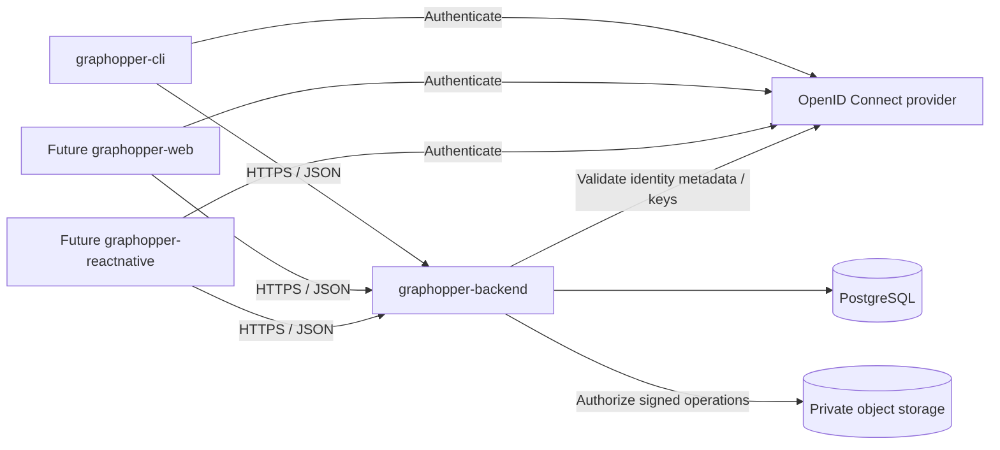
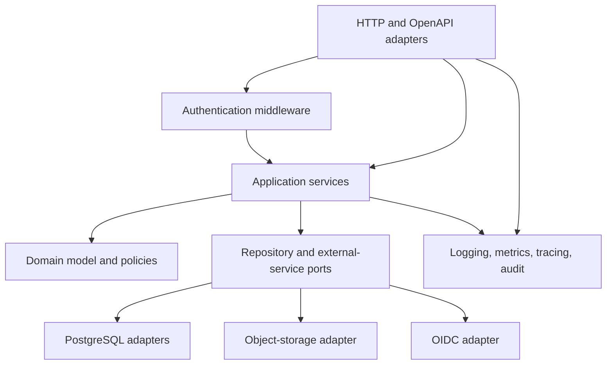
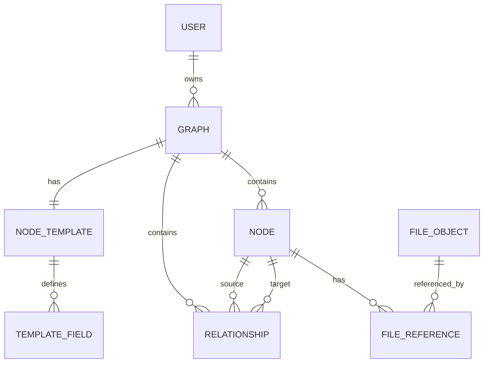
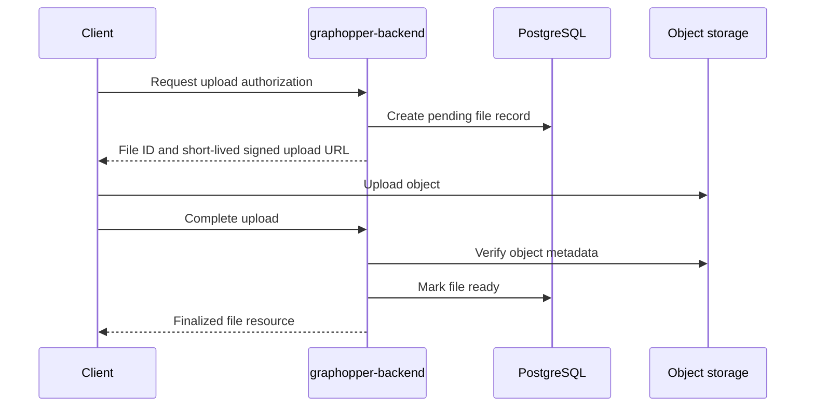
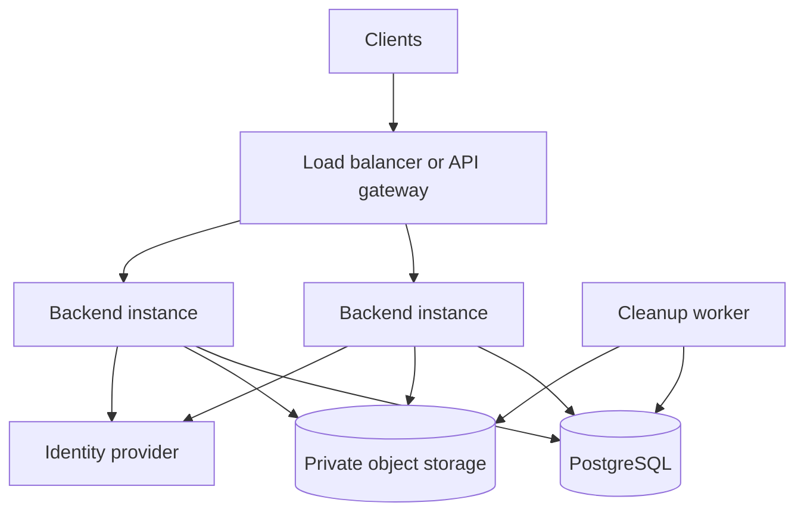

# graphopper-backend Design

## 1. Document Status

This document defines the initial solution and software architecture for graphopper-backend. It translates the functional requirements in `REQUIREMENTS.md` into an implementable backend design.

The design is authoritative for backend structure and technical behavior unless superseded by a recorded architectural decision. Exact programming language, framework, identity provider, cloud provider, and deployment platform remain open.

## 2. Goals

graphopper-backend shall:

- Provide a stable API for graphopper-cli and future web and mobile clients.
- Enforce authentication, ownership, and per-user data isolation at every resource boundary.
- Store graphs, one uniform node template per graph, nodes, node values, and relationships.
- Apply node-template changes atomically to all affected nodes.
- Support filtering, search, pagination, and bounded graph traversal.
- Store private files without exposing storage credentials or permanent public URLs.
- Remain simple to deploy initially while preserving clear internal module boundaries.
- Produce sufficient diagnostics and audit information without logging credentials or private node values by default.

## 3. Non-Goals

The initial architecture does not provide:

- Microservices for individual domain areas.
- A dedicated graph database.
- Cross-graph relationships.
- Shared graphs or multi-user collaboration.
- Multiple node templates within one graph.
- Arbitrary fields on individual nodes.
- Relationship templates or custom relationship attributes.
- Offline synchronization.
- A public graph-publishing mechanism.
- An administrator interface for browsing user data.

## 4. Architecture Decisions

### 4.1 Modular Monolith

The backend shall initially be deployed as one stateless application containing independently structured domain modules.

This provides:

- One transactional boundary for graphs, templates, nodes, and relationships.
- Simple deployment and local development.
- No distributed consistency requirement for core graph operations.
- Clear module seams that can be extracted later if independent scaling becomes necessary.

Modules shall interact through application-service interfaces rather than accessing one another's database implementation directly.

### 4.2 Versioned REST API

The public interface shall be a versioned REST API using JSON over HTTPS. The initial base path shall be `/v1`.

An OpenAPI description shall be maintained as the machine-readable API contract. The API contract, rather than internal source types, is the integration boundary for clients.

### 4.3 PostgreSQL as the System of Record

PostgreSQL shall be the authoritative datastore for users, graphs, templates, nodes, relationships, file metadata, and audit records.

A separate graph database is not justified initially because:

- Ownership and template mutation require strong relational transactions.
- Relationships can be represented as an indexed adjacency table.
- Bounded traversal can be implemented with recursive queries.
- Operating one primary datastore reduces consistency and operational complexity.

A read-optimized graph projection may be introduced later if measured traversal workloads cannot be met by PostgreSQL.

### 4.4 JSONB Node Values

Each node's template-defined values shall be stored in one JSONB object keyed by stable template-field identifier.

Example:

```json
{
  "018f3d7e-67f2-7aa1-b8ad-5d72b13a4101": "Ada Lovelace",
  "018f3d80-ae10-7780-8c76-9c49c1b41d67": "1815-12-10",
  "018f3d82-0c19-72cb-a291-7a612111dd4a": null
}
```

Stable field identifiers prevent a display-label or machine-key rename from requiring node-value rewrites. The application layer shall validate every value against the corresponding field definition before persistence.

### 4.5 External Identity Provider

Authentication shall use an OpenID Connect-compatible identity provider. graphopper-backend shall validate access tokens and map the token's issuer and subject to a local user record.

The identity provider shall own credentials, password recovery, multi-factor authentication, and self-registration when enabled. graphopper-backend shall not store user passwords.

### 4.6 Private Object Storage

Uploaded photos and files shall be stored in private S3-compatible object storage. Clients shall upload and download through short-lived signed URLs authorized by graphopper-backend.

### 4.7 Initial Hard Deletion

The initial design uses hard deletion. Database foreign keys and explicit service operations shall remove dependent data atomically. Object deletion is coordinated asynchronously because object storage cannot participate in a PostgreSQL transaction.

Audit records may retain non-sensitive facts about a deletion, such as actor, resource type, resource identifier, and timestamp, but shall not retain deleted node values by default.

## 5. System Context



### 5.1 Trust Boundaries

- All client input is untrusted.
- A valid access token proves identity but not ownership of a requested graph resource.
- graphopper-backend is the sole authority for business validation and ownership checks.
- PostgreSQL and object storage are private infrastructure and shall not be directly accessible by clients.
- Signed object-storage URLs grant narrow, time-limited access only to the authorized object and operation.

## 6. Internal Architecture



Dependencies shall point inward toward application and domain behavior. Domain code shall not depend on HTTP, a specific web framework, SQL libraries, or an object-storage SDK.

### 6.1 Modules

| Module | Responsibilities |
| --- | --- |
| API | Routing, request decoding, response encoding, OpenAPI validation, content negotiation |
| Authentication | Token validation, identity context, local-user resolution |
| Authorization | Ownership policies and resource-access decisions |
| Users | Local user profile and identity mapping |
| Graphs | Graph lifecycle and metadata |
| Templates | Template-field lifecycle, schema validation, template migrations |
| Nodes | Node lifecycle and node-value validation |
| Relationships | Relationship lifecycle and referential validation |
| Query | Filtering, search, sorting, pagination, complete-graph reads |
| Traversal | Bounded incoming, outgoing, and bidirectional traversal |
| Files | Upload authorization, finalization, download authorization, cleanup |
| Audit | Security and mutation audit records |
| Observability | Logs, metrics, traces, health and readiness |

## 7. Domain Model



### 7.1 User

A user is identified locally and linked to one external identity using the pair `(issuer, subject)`. The local identifier is used for ownership and auditing.

### 7.2 Graph

A graph is the aggregate boundary for template, node, and relationship consistency. It contains:

- Owner identifier
- Name and optional description
- Template version
- Resource version for optimistic concurrency
- Creation and update timestamps

### 7.3 Node Template and Template Field

Every graph has one logical node template. The template exists with the graph even when it has no fields.

The template has its own stable identifier and timestamps. Its schema version is stored on the graph aggregate so graph locking, node validation, and template concurrency all use one authoritative counter.

A template field contains:

- Stable identifier
- Graph identifier
- Machine-readable key
- Display label
- Data type
- Required flag
- Description
- Default value
- Display order
- Validation rules
- Resource version and timestamps

The stable field identifier is immutable. The machine-readable key may be renamed because stored node values use the stable identifier.

### 7.4 Node

A node belongs to exactly one graph. Its `values` object may contain only field identifiers defined by the graph's template.

Missing and explicit-null values shall be normalized as follows:

- Missing optional field: no key is stored.
- Explicitly cleared optional field: the key is removed.
- API responses return only stored values by default.
- A resolved representation may include defaults and explicit nulls when requested.
- Required fields must have a stored, non-null valid value.

Default values are copied into a node when it is created. A later change to a template default does not retroactively alter existing nodes.

### 7.5 Relationship

A relationship is a directed edge containing:

- Graph identifier
- Source node identifier
- Target node identifier
- Type
- Optional display label
- Resource version and timestamps

Multiple relationships between the same nodes are permitted. An exact duplicate is defined as the same graph, source, target, and type. Exact duplicates are permitted by the requirements but clients should avoid creating them unintentionally.

### 7.6 Domain Invariants

The application and persistence layers shall jointly enforce these invariants:

1. Every graph has exactly one owner.
2. Every graph has exactly one logical template.
3. Template-field keys are unique within a graph.
4. A node belongs to one graph and conforms to that graph's current template version.
5. A node value references an existing field in the same graph.
6. A required field has a valid non-null value on every node.
7. A relationship and both endpoint nodes belong to the same graph.
8. A graph-owned resource cannot be moved through an ordinary update.
9. A user cannot access a resource through another user's graph identifier.
10. A template mutation is applied completely or not at all.

## 8. Persistence Design

### 8.1 Proposed Tables

#### `users`

| Column | Purpose |
| --- | --- |
| `id` | Opaque primary key |
| `identity_issuer` | Normalized token issuer |
| `identity_subject` | Provider subject |
| `display_name` | Optional synchronized profile value |
| `email` | Optional synchronized profile value |
| `status` | Active or disabled local status |
| `created_at`, `updated_at` | Audit timestamps |

Unique constraint: `(identity_issuer, identity_subject)`.

#### `graphs`

| Column | Purpose |
| --- | --- |
| `id` | Opaque primary key |
| `owner_id` | Owning user |
| `name` | Graph name |
| `description` | Optional description |
| `template_version` | Incremented for every template mutation |
| `version` | Optimistic concurrency version |
| `created_at`, `updated_at` | Audit timestamps |

Indexes: `(owner_id, created_at, id)` and `(owner_id, name, id)`.

#### `node_templates`

| Column | Purpose |
| --- | --- |
| `id` | Stable template identifier |
| `graph_id` | Owning graph; unique and immutable |
| `created_at`, `updated_at` | Template audit timestamps |

The graph and its empty template shall be inserted in the same transaction. Unique `graph_id` enforces one template per graph, and the graph foreign key cascades on graph deletion. The aggregate's current schema version is `graphs.template_version`.

#### `template_fields`

| Column | Purpose |
| --- | --- |
| `id` | Stable field identifier |
| `graph_id` | Owning graph |
| `key` | Machine-readable key |
| `label` | Display label |
| `data_type` | Supported type discriminator |
| `required` | Required-value rule |
| `description` | Optional help text |
| `default_value` | Typed value represented as JSONB |
| `validation_rules` | Versioned validation-rule object |
| `display_order` | Client presentation order |
| `version` | Optimistic concurrency version |
| `created_at`, `updated_at` | Audit timestamps |

Constraints:

- Unique `(graph_id, key)`.
- Unique `(graph_id, display_order)` is not required; ordering ties fall back to field identifier.
- The graph foreign key cascades on graph deletion.

#### `nodes`

| Column | Purpose |
| --- | --- |
| `id` | Opaque primary key |
| `graph_id` | Parent graph |
| `template_version` | Template version used for the last successful validation |
| `values` | JSONB map of field identifier to canonical value |
| `version` | Optimistic concurrency version |
| `created_at`, `updated_at` | Audit timestamps |

Indexes:

- `(graph_id, created_at, id)` for listing.
- GIN index on `values` for supported containment queries.
- Targeted expression indexes may be added for demonstrated high-value fields and query patterns.

Constraint: unique `(graph_id, id)`. This candidate key supports composite relationship foreign keys that prove both endpoints belong to the relationship's graph.

#### `relationships`

| Column | Purpose |
| --- | --- |
| `id` | Opaque primary key |
| `graph_id` | Parent graph |
| `source_node_id` | Directed source |
| `target_node_id` | Directed target |
| `type` | Machine-readable relationship type |
| `label` | Optional display label |
| `version` | Optimistic concurrency version |
| `created_at`, `updated_at` | Audit timestamps |

Indexes:

- `(graph_id, source_node_id, type, id)`.
- `(graph_id, target_node_id, type, id)`.
- `(graph_id, type, id)`.

Composite foreign-key enforcement shall ensure that each endpoint has the same `graph_id` as the relationship. Deleting a node cascades to its incoming and outgoing relationships.

#### `file_references`

| Column | Purpose |
| --- | --- |
| `file_id` | Referenced managed file |
| `node_id` | Referencing node |
| `field_id` | Referencing image/file template field |
| `graph_id` | Shared parent graph used for integrity checks |
| `created_at` | Reference creation timestamp |

Primary key: `(file_id, node_id, field_id)`. Composite foreign keys shall ensure that the file, node, and field all belong to the same graph.

Node JSONB remains the authoritative API value representation. `file_references` is a transactionally maintained integrity index used to prevent unauthorized or dangling references, locate references efficiently, and determine when a managed object is orphaned.

#### `file_objects`

| Column | Purpose |
| --- | --- |
| `id` | Opaque file identifier |
| `owner_id` | Owning user |
| `graph_id` | Owning graph |
| `object_key` | Private storage key |
| `state` | Pending, ready, rejected, or deletion-pending |
| `original_name` | Sanitized display filename |
| `media_type` | Verified media type |
| `size_bytes` | Verified object size |
| `checksum` | Optional integrity checksum |
| `expires_at` | Expiry for abandoned pending upload |
| `created_at`, `updated_at` | Audit timestamps |

The object key shall be generated by the backend and shall not contain an untrusted path supplied by a client.

#### `audit_events`

Audit records shall contain actor, action, resource type, resource identifier, graph identifier where applicable, outcome, request identifier, and timestamp. Node values, tokens, and signed URLs shall not be stored by default.

#### `outbox_events`

An outbox table shall record object-deletion and cleanup work committed with the associated database change. A worker processes the events idempotently.

### 8.2 Identifier Strategy

Externally visible identifiers shall be opaque, non-sequential values. UUIDv7 is recommended because it is globally unique and index-friendly while remaining opaque to clients.

Clients shall not infer ownership, type, or creation time from identifiers.

### 8.3 Timestamps

All persisted timestamps shall use UTC. API timestamps shall use RFC 3339 representations with an explicit offset.

## 9. Value Type System

The API shall use canonical JSON representations:

| Template type | JSON representation | Canonical rules |
| --- | --- | --- |
| Text | String | Length and pattern rules may apply |
| Long text | String | Separate, larger configured length limit |
| Integer | Number | Integral and within configured range |
| Decimal | String | Canonical decimal string to avoid binary floating-point loss |
| Boolean | Boolean | `true` or `false` only |
| Date | String | ISO 8601 full date, `YYYY-MM-DD` |
| Date and time | String | RFC 3339 with offset, normalized to UTC internally |
| URL | String | Absolute URL using an allowed scheme |
| Image or file reference | String | Opaque finalized file identifier or allowed external URL |

Validation rules shall be represented by a versioned object so new rule types can be introduced without changing existing meanings. Initially supported rules should include string length, regular-expression pattern, numeric minimum and maximum, allowed-value enumeration, and supported file media types.

Cross-field rules shall refer to stable field identifiers, not display labels or machine keys.

## 10. Authentication Design

### 10.1 Client Authentication

- Browser and mobile clients should use Authorization Code with PKCE.
- CLI clients should use an identity-provider-supported device authorization flow or a loopback authorization-code flow with PKCE.
- Non-interactive automation shall use a separately approved identity-provider flow suitable for its trust model.
- The backend API shall accept bearer access tokens and shall not accept end-user passwords.

### 10.2 Token Validation

For every authenticated request, authentication middleware shall validate:

- Signature using trusted issuer keys.
- Issuer.
- Audience.
- Expiration and not-before time.
- Required scopes or claims.
- Token type where provided.

Signing keys may be cached according to provider metadata, with safe refresh on key rotation. A failure to retrieve new keys shall not cause unknown or invalid signatures to be accepted.

### 10.3 Local User Provisioning

On the first valid request from a recognized issuer and subject, the backend may create a local user record if just-in-time provisioning is enabled. Otherwise the identity must already be registered.

Profile claims are informational and shall not be used as ownership identifiers. The `(issuer, subject)` pair is the external identity key.

### 10.4 Sign-Out and Revocation

Local sign-out is primarily a client and identity-provider operation. If the provider supports token revocation, the client may invoke it directly or through an authorized backend integration. The backend shall reject expired tokens and any revoked sessions it is capable of detecting.

## 11. Authorization and Data Isolation

### 11.1 Ownership Policy

Every graph operation shall be scoped by both `graph_id` and the authenticated local `user_id`.

Repositories shall expose owner-scoped operations such as:

```text
findGraph(userId, graphId)
findNode(userId, graphId, nodeId)
updateRelationship(userId, graphId, relationshipId, change)
```

Repositories shall not expose unscoped graph-owned lookup methods to ordinary application services.

### 11.2 Inaccessible Resources

For an ordinary user request, an absent resource and a resource owned by another user shall both produce `404 RESOURCE_NOT_FOUND`. This prevents identifier probing from revealing another user's private data.

Authentication failures return `401`. A `403` response is reserved for cases where the resource is intentionally visible to the caller but the requested action is forbidden; the initial private ownership model rarely requires it.

### 11.3 Defense in Depth

The application layer shall always enforce ownership. PostgreSQL row-level security may be added as defense in depth, but it shall not be the only authorization mechanism. If used, every transaction must set a verified user context and tests must prove that connection pooling cannot leak context between requests.

## 12. API Design

### 12.1 Resource Paths

The initial API shall use these resource families:

| Method and path | Purpose |
| --- | --- |
| `GET /v1/me` | Current local user |
| `POST /v1/graphs` | Create graph, optionally with initial template fields |
| `GET /v1/graphs` | List owned graphs |
| `GET /v1/graphs/{graphId}` | Retrieve graph metadata and template summary |
| `PATCH /v1/graphs/{graphId}` | Update graph metadata |
| `DELETE /v1/graphs/{graphId}` | Delete graph and dependents |
| `GET /v1/graphs/{graphId}/template` | Retrieve the complete template |
| `POST /v1/graphs/{graphId}/template/fields` | Add template field |
| `PATCH /v1/graphs/{graphId}/template/fields/{fieldId}` | Change template field |
| `DELETE /v1/graphs/{graphId}/template/fields/{fieldId}` | Delete field and node values |
| `POST /v1/graphs/{graphId}/nodes` | Create node |
| `GET /v1/graphs/{graphId}/nodes` | List, filter, search, and sort nodes |
| `GET /v1/graphs/{graphId}/nodes/{nodeId}` | Retrieve node |
| `PATCH /v1/graphs/{graphId}/nodes/{nodeId}` | Partially update node values |
| `DELETE /v1/graphs/{graphId}/nodes/{nodeId}` | Delete node and relationships |
| `POST /v1/graphs/{graphId}/relationships` | Create relationship |
| `GET /v1/graphs/{graphId}/relationships` | List and filter relationships |
| `GET /v1/graphs/{graphId}/relationships/{relationshipId}` | Retrieve relationship |
| `PATCH /v1/graphs/{graphId}/relationships/{relationshipId}` | Update relationship type or label |
| `DELETE /v1/graphs/{graphId}/relationships/{relationshipId}` | Delete relationship |
| `GET /v1/graphs/{graphId}/traversals` | Traverse from a starting node |
| `GET /v1/graphs/{graphId}/data` | Retrieve a bounded graph-data page or snapshot |
| `POST /v1/graphs/{graphId}/files` | Authorize a pending upload |
| `POST /v1/graphs/{graphId}/files/{fileId}/complete` | Verify and finalize upload |
| `GET /v1/graphs/{graphId}/files/{fileId}/download` | Authorize a short-lived download |
| `DELETE /v1/graphs/{graphId}/files/{fileId}` | Remove an unreferenced file |

The final OpenAPI contract may refine names while preserving these resource boundaries.

### 12.2 Request and Response Conventions

- JSON property names shall use lower camel case.
- Unknown request properties shall be rejected by default to catch client mistakes.
- Unknown response properties must be tolerated by clients.
- System-managed fields are read-only.
- `PATCH` uses merge semantics only for supplied mutable properties.
- To clear an optional node value, the client sends the field identifier with `null`; the service removes the stored key.
- Resource responses include `id`, `version`, `createdAt`, and `updatedAt` where applicable.
- Successful creation returns `201` and the created resource.
- Successful deletion returns `204`.
- Repeating deletion of a missing or already deleted private resource returns `204`, provided the request identifies a valid parent graph owned by the caller; otherwise it returns the normal non-disclosing `404`.

### 12.3 Optimistic Concurrency

Mutable resources shall expose an `ETag` derived from their version. Update and destructive operations that can lose concurrent changes should accept `If-Match`.

If the supplied version is stale, the API returns `412 PRECONDITION_FAILED` with error code `RESOURCE_VERSION_MISMATCH`.

Template-changing operations shall require `If-Match` against the graph/template version.

### 12.4 Error Envelope

```json
{
  "error": {
    "code": "NODE_VALUE_INVALID",
    "message": "One or more node values are invalid.",
    "details": [
      {
        "fieldId": "018f3d80-ae10-7780-8c76-9c49c1b41d67",
        "reason": "Expected an ISO 8601 date."
      }
    ],
    "requestId": "01J5M1Z8B86P3R4AWDWDYVAKN7"
  }
}
```

Stable error categories shall include:

- `AUTHENTICATION_REQUIRED`
- `TOKEN_INVALID`
- `RESOURCE_NOT_FOUND`
- `VALIDATION_FAILED`
- `NODE_VALUE_INVALID`
- `TEMPLATE_CONFLICT`
- `RESOURCE_VERSION_MISMATCH`
- `QUERY_LIMIT_EXCEEDED`
- `FILE_NOT_READY`
- `RATE_LIMITED`
- `INTERNAL_ERROR`

Internal exceptions, SQL details, object keys, credentials, and stack traces shall never appear in public responses.

### 12.5 Pagination

List endpoints shall use opaque cursor pagination.

```json
{
  "items": [],
  "page": {
    "nextCursor": "opaque-or-null",
    "hasMore": false
  }
}
```

A cursor shall encode the applied sort, final sort value, tie-breaking identifier, and query version or signature. It shall be integrity-protected so clients cannot alter internal query state.

Page sizes shall have configurable defaults and hard maximums. Results shall use a deterministic tie-breaker.

### 12.6 Complete Graph Retrieval

`GET /v1/graphs/{graphId}/data` shall return the template plus bounded node and relationship collections. Small graphs may fit in one response. Larger graphs shall return pagination cursors or a truncation indicator.

The API shall not load an unbounded graph into application memory. If a future use case requires a consistent full export, it shall use a separate asynchronous export workflow rather than weakening normal API limits.

## 13. Template Mutation Design

Template changes are graph-wide schema changes. Every operation shall execute in a database transaction and lock the owning graph row.

### 13.1 General Algorithm

1. Resolve the graph using authenticated `user_id` and `graph_id`.
2. Lock the graph row for update.
3. Verify `If-Match` or expected template version.
4. Load the current template fields.
5. Validate the proposed definition.
6. Validate or transform affected node values.
7. Apply field and node changes.
8. Increment `template_version` and graph resource version.
9. Append an audit event.
10. Commit atomically.

A concurrent node write shall lock or recheck the graph template version before commit. It must not persist values validated against an obsolete template.

### 13.2 Adding an Optional Field

- Add the field definition.
- Existing nodes remain without a stored key unless the operation explicitly requests materialization of the default.
- New nodes receive the default when one exists.

### 13.3 Adding a Required Field

The operation shall require either:

- A valid default that is materialized into every existing node; or
- A complete mapping of valid values for all existing nodes.

If any node cannot be updated, the transaction rolls back.

### 13.4 Renaming a Label or Key

The stable field identifier remains unchanged, so node values require no rewrite. Cross-field rules continue referring to the stable identifier.

### 13.5 Changing Data Type

The client shall specify an allowed conversion policy. The service shall attempt conversion for every non-null existing value within the transaction.

Lossy or ambiguous conversion shall be rejected unless a future explicitly named conversion mode permits it. Any failed conversion rolls back the entire operation.

### 13.6 Changing Required Status

- Required to optional: update the definition without rewriting values.
- Optional to required: verify every node has a valid non-null value, or materialize a supplied valid default.

### 13.7 Deleting a Field

Deletion requires an explicit destructive-confirmation property in addition to normal authorization and version checks. The operation removes the field identifier from every node's JSONB values, deletes the field, increments the template version, and records an audit event.

File references removed by the change shall be checked for remaining references. Newly orphaned managed files shall be marked deletion-pending and added to the outbox.

### 13.8 Large-Graph Limit

Synchronous template mutations shall have configurable node-count and transaction-time limits. If the limit would be exceeded, the initial API returns `TEMPLATE_MIGRATION_TOO_LARGE` without changing data.

An asynchronous migration state machine may be introduced later. Until then, the backend shall not leave a graph in a partially migrated state.

## 14. Node Operations

### 14.1 Create

Node creation shall:

1. Resolve and authorize the graph.
2. Read the current template and version.
3. Reject unknown field identifiers.
4. Apply configured defaults.
5. Validate types, field rules, required values, and cross-field rules.
6. Insert the node with the validated template version.
7. Recheck or lock the graph version so a concurrent template mutation cannot invalidate the node.

### 14.2 Partial Update

An update shall merge only supplied values:

- A valid non-null value sets or replaces the field value.
- `null` removes an optional field value.
- `null` for a required field is rejected.
- Omitted fields remain unchanged.

The fully resolved candidate node shall be validated before persistence so cross-field rules remain correct.

### 14.3 Delete

Node deletion and cascading relationship deletion shall occur in one PostgreSQL transaction. Managed files that become unreferenced shall be scheduled for cleanup through the outbox.

## 15. Relationship and Traversal Design

### 15.1 Relationship Writes

Relationship creation shall resolve the graph and both nodes in one owner-scoped transaction. Composite database constraints provide defense against cross-graph endpoints.

Self-references and multiple edges are permitted. Relationship type and label shall be subject to configured length and character limits.

### 15.2 Traversal

Traversal shall use a recursive common-table expression over the relationship indexes. Inputs include:

- Start node identifier
- Direction: outgoing, incoming, or both
- Optional relationship types
- Maximum depth
- Maximum returned nodes
- Maximum returned relationships

The query shall track visited nodes and/or edges to prevent infinite cycles. The response shall include reached nodes, traversed relationships, depth information where requested, and `truncated: true` when a configured limit stops traversal.

The service shall enforce hard depth, result-count, execution-time, and response-size limits regardless of client input.

## 16. Query and Search Design

### 16.1 Field Filtering

The node-list API shall accept filters referencing stable field identifiers. Each filter includes an operator and value appropriate to the field type.

Initially supported operators should include:

- Equality and inequality
- Existence and missing
- Numeric/date comparison
- Text prefix or contains, subject to safe limits
- Membership in a bounded list

The query service shall load the field definition, validate the filter value, and generate parameterized SQL. Clients cannot submit raw SQL, JSON paths, regular expressions, or sort expressions.

### 16.2 Search

Text search shall initially target explicitly requested text fields within one graph. A normalized search expression or maintained search vector may be introduced based on measured use. Search is never allowed across another user's graphs.

### 16.3 Sorting

Sorting shall be limited to an allowlist of system fields and compatible template fields. Every order includes the node identifier as a deterministic tie-breaker.

### 16.4 Query Evolution

Arbitrary JSONB queries can become expensive. The service shall measure query latency and use query plans during performance testing. Frequently filtered fields may receive expression indexes or a derived typed index table. A separate search or graph datastore shall be introduced only after workload evidence justifies it.

## 17. File Lifecycle



### 17.1 Upload

- The backend validates graph ownership and requested media type before authorizing an upload.
- The signed upload restricts object key, operation, expiry, and expected size or media type where the storage provider supports it.
- A file cannot be referenced by a node until its state is `ready`.
- Completion verifies that the object exists and satisfies size, media-type, and checksum rules.
- Malware scanning may be required before readiness in deployments that accept untrusted files.

### 17.2 Download

The backend shall authorize the current user against the owning graph before issuing a short-lived signed download URL. The API shall not expose permanent public URLs or raw storage credentials.

### 17.3 Cleanup

- Pending uploads expire and are cleaned up asynchronously.
- Database deletion marks managed objects deletion-pending and commits an outbox event.
- File orphan checks use the transactionally maintained `file_references` table rather than scanning arbitrary JSONB values.
- A worker deletes the object idempotently and then finalizes metadata deletion.
- Failed deletion is retried with bounded backoff and surfaced in metrics.
- External URLs are never deleted by graphopper-backend.

## 18. Transactions and Concurrency

### 18.1 Transaction Boundaries

One database transaction shall cover each mutation of graph metadata, template, node, or relationship state and its corresponding audit/outbox records.

No database transaction shall remain open while waiting for a client upload or other long-running external interaction.

### 18.2 Locking

- Ordinary graph metadata updates use optimistic concurrency.
- Template mutations lock the graph row.
- Node writes verify the graph's template version within their transaction.
- Relationship creation relies on endpoint foreign keys and transactional existence checks.
- Lock acquisition shall follow a consistent graph-before-child order to reduce deadlock risk.

### 18.3 Retries and Idempotency

Safe reads and idempotent operations may be retried after transient failures. Creation endpoints should accept an `Idempotency-Key` scoped to user, endpoint, and normalized request body.

Idempotency records shall have a bounded retention period and shall return the original response for an exact retry. Reuse of a key with a different request body is rejected.

## 19. Deletion Semantics

The initial hard-deletion rules are:

| Deleted resource | Database consequence | Object-storage consequence |
| --- | --- | --- |
| Graph | Delete template fields, nodes, relationships, and file references | Schedule newly orphaned managed files |
| Template field | Remove its key from all nodes, then delete field | Schedule newly orphaned managed files |
| Node | Delete node and connected relationships | Schedule newly orphaned managed files |
| Relationship | Delete relationship | None |
| File | Allowed only when unreferenced | Schedule object deletion |

Deletion responses shall not reveal whether a resource belongs to another user. Audit events shall record destructive actions and outcomes without retaining the deleted content.

## 20. Security Design

### 20.1 Transport and Network

- Public traffic shall use TLS.
- PostgreSQL and object storage shall use encrypted connections on private network paths.
- Administrative and migration interfaces shall not be publicly exposed.

### 20.2 Application Security

- Validate request shape, length, count, and content type before domain processing.
- Use parameterized SQL exclusively.
- Apply allowlists for filter fields, sort fields, operators, URL schemes, and upload media types.
- Enforce configured request-body and response-size limits.
- Rate-limit authentication failures, expensive queries, traversals, and upload authorization.
- Reject ambiguous duplicate JSON properties at the HTTP parsing boundary where supported.
- Apply a restrictive CORS allowlist when browser clients are introduced.

### 20.3 Secrets

Secrets shall be injected through an approved secret manager or runtime mechanism. They shall not be stored in source control, committed configuration, images, logs, traces, or error responses.

### 20.4 Logging Privacy

Logs shall include identifiers and operation metadata but not bearer tokens, signed URLs, full request bodies, node-value payloads, or uploaded content. Explicit diagnostic sampling of private values is prohibited unless a separately approved, access-controlled process is introduced.

## 21. Audit and Observability

### 21.1 Structured Logs

Every request shall have a request identifier. Logs should include:

- Request identifier
- Trace identifier where enabled
- Authenticated local user identifier after authentication
- Route template, method, status, and duration
- Graph/resource identifiers where safe
- Stable error code

### 21.2 Metrics

At minimum, emit metrics for:

- Request rate, latency, and error rate by route group
- Database pool usage and query latency
- Authentication and authorization failures
- Template mutation duration and affected-node count
- Traversal depth, returned size, truncation, and timeout
- Upload authorization, completion, rejection, and cleanup
- Outbox backlog and retry failures

### 21.3 Tracing

Tracing should cover HTTP handling, application services, database calls, identity-provider metadata retrieval, and object-storage calls. Sensitive payloads shall not be attached to spans.

### 21.4 Health Endpoints

- Liveness indicates that the process can serve requests.
- Readiness verifies required dependencies, including database connectivity.
- Identity-provider and object-storage degradation shall be represented according to whether the affected operation is essential to general API readiness.

Health responses shall not expose credentials, internal topology, or detailed dependency errors publicly.

## 22. Deployment Topology



Backend instances shall be stateless so they can be replaced and horizontally scaled. Database migrations shall run as a controlled deployment step, not concurrently in every application instance.

The cleanup worker may initially run from the same deployable artifact with a distinct process role. It shall not require a separate service codebase.

### 22.1 Backup and Recovery

Production deployments shall provide:

- Automated PostgreSQL backups and point-in-time recovery appropriate to the target recovery objectives.
- Object-storage durability and lifecycle configuration.
- Tested restore procedures.
- Migration rollback or forward-fix procedures.
- Monitoring for failed backups and excessive outbox backlog.

Exact recovery-time and recovery-point objectives are deployment decisions and remain open.

## 23. API Evolution

- Additive response fields are backward-compatible within `/v1`.
- Removing or changing the meaning or type of a field requires a new API version or a documented compatibility process.
- New optional request properties may be added only if older clients remain valid.
- Stable error codes shall not be repurposed.
- Deprecations shall be documented with migration guidance and a support window.
- Database schema versions and public API versions are independent.

## 24. Testing Strategy

### 24.1 Unit Tests

Unit tests shall cover:

- Template-field definition validation
- Canonical value parsing
- Required and default behavior
- Cross-field rules
- Template conversion policies
- Authorization policies
- Pagination cursor validation
- Error mapping

### 24.2 Database Integration Tests

Integration tests shall run against a real supported PostgreSQL version and cover:

- Constraints and cascades
- Owner-scoped repository queries
- JSONB filtering and sorting
- Recursive traversal with cycles
- Atomic template migrations
- Concurrent node and template changes
- Idempotency behavior
- Outbox persistence

### 24.3 API Contract Tests

Contract tests shall verify request and response schemas, status codes, error codes, pagination, partial updates, conditional requests, and compatibility with the checked-in OpenAPI document.

### 24.4 Security Tests

Automated tests shall attempt:

- Cross-user graph, template, node, relationship, and file access
- Identifier probing
- Cross-graph relationship creation
- Unknown field injection
- Invalid or expired tokens
- Unsafe filters and sort expressions
- Oversized traversal and upload requests
- Credential and signed-URL leakage into logs

### 24.5 File Tests

File tests shall cover pending upload expiry, metadata verification, unauthorized download, referenced-file deletion rejection, orphan detection, outbox retry, and idempotent object deletion.

### 24.6 End-to-End Tests

End-to-end tests shall exercise a complete user flow through a test identity provider:

1. Authenticate.
2. Create a graph and template.
3. Create nodes.
4. Create and traverse relationships.
5. Upload and reference a photo.
6. Modify the template.
7. Verify ownership isolation with a second user.
8. Delete resources and verify cascades.

## 25. Requirements Traceability

| Requirement group | Primary design sections | Verification focus |
| --- | --- | --- |
| `FR-AUTH-*` | 10, 12, 20 | Token validation, provisioning, current user, revocation behavior |
| `FR-AUTHZ-*` | 5, 11, 20 | Owner-scoped access and non-disclosure |
| `FR-GRAPH-*` | 7, 8, 12, 19 | Graph lifecycle, template ownership, cascades |
| `FR-TEMPLATE-*` | 7, 9, 13 | Atomic schema changes and value migration |
| `FR-NODE-*` | 7, 9, 14 | Template conformance and partial updates |
| `FR-REL-*` | 7, 8, 15 | Same-graph endpoints, direction, traversal |
| `FR-FILE-*` | 8, 17, 19, 20 | Private upload, access, replacement, cleanup |
| `FR-QUERY-*` | 12, 15, 16 | Pagination, filters, search, sorting, traversal |
| `FR-VAL-*` | 9, 13, 14, 18 | Validation and transactional atomicity |
| `FR-API-*` | 12, 23 | Contract, errors, update and deletion semantics |
| `FR-AUDIT-*` | 8, 19, 21 | Timestamps, actor, mutation audit events |

## 26. Risks and Evolution Triggers

| Risk | Initial mitigation | Evolution trigger |
| --- | --- | --- |
| Template migration locks a large graph | Synchronous limits, transaction timeout, affected-node estimate | Introduce asynchronous versioned migration workflow |
| JSONB filtering becomes slow | GIN index, query allowlist, metrics | Add expression indexes or typed derived index table |
| Recursive traversal becomes expensive | Depth, result, time, and response limits | Add read projection or graph datastore after measured need |
| Identity provider is unavailable | Cache signing keys safely; distinguish existing-token validation from login | Add provider redundancy according to deployment needs |
| Database/object deletion is not atomic | Transactional outbox and idempotent worker | Reconcile periodically if failure rate warrants it |
| Complete graph responses become too large | Bounded data endpoint and pagination | Add asynchronous export or streaming format |
| Audit data exposes private content | Metadata-only default and restricted access | Add separately governed detailed audit store only if required |

## 27. Open Decisions

The following decisions shall be resolved before or during implementation and recorded explicitly:

1. Programming language and backend framework.
2. Database access and migration tooling.
3. OpenID Connect provider and supported client flows.
4. Whether UUIDv7 is supported directly by the selected runtime and database version.
5. Exact OpenAPI authoring and code-generation workflow.
6. Maximum request body, page size, graph-data response, traversal depth, and traversal result size.
7. Supported file media types, file-size limits, malware-scanning policy, and upload expiry.
8. Exact field validation-rule schema and initial cross-field operators.
9. Template-migration synchronous size limit.
10. Idempotency-key retention period and eligible endpoints.
11. Rate-limit policies.
12. Audit retention and access policy.
13. Backup recovery-time and recovery-point objectives.
14. Deployment platform and secret-management system.

## 28. Implementation Sequence

The recommended implementation order is:

1. Establish project structure, configuration, migrations, health endpoints, and observability baseline.
2. Implement token validation, local-user mapping, and owner-scoped authorization primitives.
3. Implement graphs and node-template retrieval.
4. Implement template fields and atomic template mutation rules.
5. Implement nodes and canonical value validation.
6. Implement relationships and bounded traversal.
7. Implement filtering, search, sorting, pagination, and graph-data retrieval.
8. Implement private file lifecycle and outbox cleanup worker.
9. Complete OpenAPI contract, integration, security, concurrency, and end-to-end test suites.
10. Validate performance limits and record deployment-specific operational decisions.
