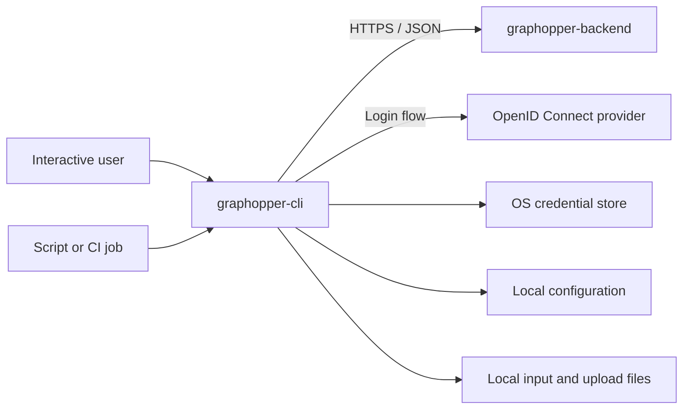
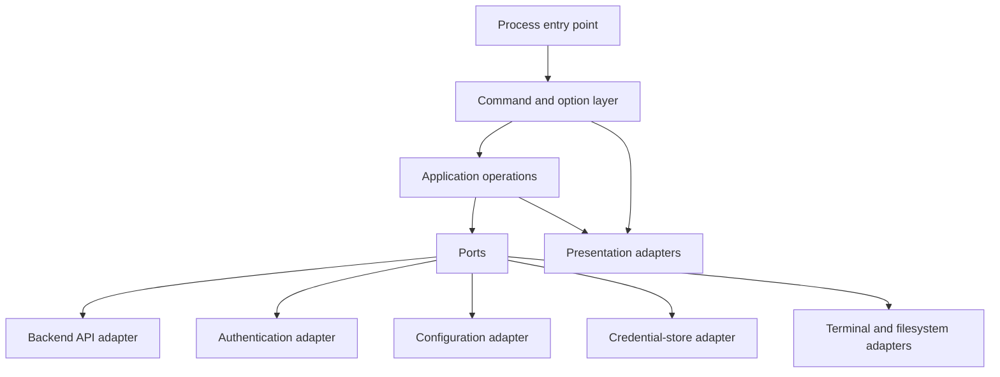
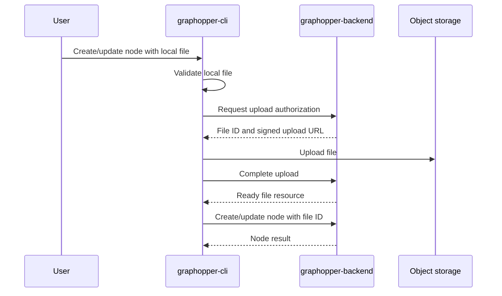

# graphopper-cli Design

## 1. Document Status

This document defines the initial solution and software architecture for graphopper-cli. It translates `REQUIREMENTS.md` into an implementable command-line design and aligns the client with the contract and security model in `../graphopper-backend/DESIGN.md`.

The document is authoritative for CLI behavior unless superseded by a recorded architectural decision. The initial technology and distribution decisions are recorded here and in `docs/decisions/0001-initial-cli-stack.md`.

## 2. Goals

graphopper-cli shall:

- Provide a safe and discoverable command-line frontend for graphopper-backend.
- Support interactive terminal users and non-interactive automation.
- Keep human-readable output separate from stable machine-readable output.
- Authenticate without handling or persisting an identity-provider password.
- Store credentials using operating-system facilities where available.
- Expose graph, template, node, relationship, traversal, and file capabilities consistently.
- Preserve backend error codes, request identifiers, resource versions, and pagination state.
- Avoid duplicating backend business rules as a security or integrity boundary.
- Behave predictably across supported terminals and operating systems.

## 3. Non-Goals

The initial CLI shall not provide:

- Direct access to graphopper-backend's database or object storage.
- Offline editing or bidirectional synchronization.
- A local graph datastore that competes with the backend as source of truth.
- A full-screen terminal user interface.
- A web or mobile interface.
- Administrative access to other users' data.
- Public graph publishing or collaborative editing.
- Client plugins or arbitrary executable extensions.
- Unbounded graph retrieval or rendering.
- Automatic inference of nodes or relationships.

## 4. System Context



### 4.1 Trust Boundaries

- Command arguments, environment variables, standard input, configuration files, backend responses, and local files are untrusted inputs.
- The OS credential store is trusted only to the degree guaranteed by the current operating-system account.
- graphopper-backend is authoritative for authentication acceptance, ownership, business validation, and persistence.
- A successful client-side check improves usability but does not prove that a backend operation is authorized or valid.
- Signed object-storage URLs are credentials and shall be handled as secrets.

## 5. Architecture

graphopper-cli shall use a command-oriented layered architecture.



The command layer shall not issue HTTP calls, read credential-store internals, or format backend-specific transport errors directly. Application operations coordinate behavior through interfaces that can be replaced in tests.

### 5.1 Components

| Component | Responsibility |
| --- | --- |
| Process runtime | Signals, cancellation, standard streams, terminal detection, exit status |
| Command layer | Parse commands, arguments, options, and contextual help |
| Application operations | Coordinate one user-visible operation |
| Configuration | Profiles, environment variables, defaults, validation, precedence |
| Authentication | Login flow, token acquisition, refresh, status, and logout |
| Credential store | Secure persistence and retrieval of credentials |
| Backend client | Versioned HTTP calls, token injection, errors, pagination, concurrency |
| Input | Prompts, structured files, standard input, and local paths |
| Presentation | Tables, detail views, JSON, identifiers, warnings, and progress |
| Confirmation | Interactive safeguards for destructive operations |
| File transfer | Signed upload/download coordination and progress |

### 5.2 Dependency Rules

- Commands depend on application operations, not directly on HTTP implementations.
- Application operations depend on backend, authentication, configuration, credential, input, and presentation ports.
- API transport models shall be translated at the adapter boundary when application-specific behavior is required.
- Backend business objects shall not be persisted locally except for bounded caches explicitly introduced later.
- Shared source code shall not be imported from graphopper-backend.

## 6. Technology Stack and Constraints

The initial implementation uses:

- Node.js 24 LTS and TypeScript 6 in strict mode.
- Commander 15 for command parsing.
- The built-in Fetch API behind an application-facing backend port.
- `@napi-rs/keyring` for OS credential storage, with no automatic plaintext fallback.
- OIDC device authorization for interactive login and `GRAPHOPPER_TOKEN` for process-only automation credentials.
- UTF-8 JSON configuration in the conventional per-user platform directory.
- npm with a committed lockfile, Vitest, ESLint, and Prettier.
- A runtime-dependent npm package supporting macOS 14+ on x64/arm64, Ubuntu 22.04+ on x64/arm64, and Windows 11 on x64.

The selected stack shall:

- Produce distributable command-line artifacts for all supported platforms.
- Support Unicode arguments, input, and output.
- Support HTTPS, JSON, OpenID Connect client flows, and cancellation.
- Integrate with native credential stores.
- Detect interactive terminals and terminal capabilities.
- Produce deterministic machine-readable output.
- Support reproducible builds and automated cross-platform tests.
- Require no compiler at installation time; the accepted initial distribution tradeoff is a Node.js 24 runtime dependency.

The CLI and backend may use different languages. The OpenAPI contract, not shared implementation code, is their integration boundary.

## 7. Command Model

The installed root command shall be `graphopper` unless packaging constraints require a documented alternative.

### 7.1 Proposed Hierarchy

```text
graphopper
├── auth
│   ├── login
│   ├── logout
│   └── status
├── config
│   ├── get
│   ├── set
│   ├── list-profiles
│   ├── use-profile
│   └── check
├── graph
│   ├── create
│   ├── list
│   ├── show
│   ├── update
│   ├── delete
│   └── data
├── template
│   ├── show
│   └── field
│       ├── add
│       ├── update
│       └── delete
├── node
│   ├── create
│   ├── list
│   ├── show
│   ├── update
│   └── delete
├── relationship
│   ├── create
│   ├── list
│   ├── show
│   ├── update
│   └── delete
├── traverse
├── completion
└── version
```

The final command parser may refine names, but resource terminology shall match graphopper-backend and remain consistent across commands.

### 7.2 Global Options

The following global options are proposed:

| Option | Purpose |
| --- | --- |
| `--profile <name>` | Select a configuration profile |
| `--server <url>` | Override the backend base URL |
| `--output <format>` | Select `table`, `detail`, `json`, or supported command-specific format |
| `--timeout <duration>` | Override request timeout within configured bounds |
| `--no-color` | Disable ANSI color |
| `--quiet` | Suppress non-result informational output |
| `--verbose` | Add safe diagnostics to standard error |
| `--yes` | Explicitly bypass a destructive confirmation |
| `--non-interactive` | Prohibit prompts and browser-launch assumptions |

An option shall have the same meaning everywhere it is accepted. Commands shall reject unknown options and incompatible combinations.

### 7.3 Help and Examples

The root and every subcommand shall provide contextual help containing:

- A concise purpose statement.
- Required arguments.
- Available options and defaults.
- Whether authentication is required.
- Whether the command may prompt.
- Destructive effects where applicable.
- At least one representative example for non-trivial commands.

Help output returns success and shall not require configuration, credentials, or backend availability.

## 8. Command Execution Lifecycle

Every command shall follow this lifecycle as applicable:

1. Parse the command, arguments, and options.
2. Establish cancellation from operating-system signals.
3. Detect terminal capabilities and determine interactive mode.
4. Resolve configuration using documented precedence.
5. Validate local input and incompatible options.
6. Resolve or acquire an authentication credential when required.
7. Retrieve backend metadata or template information needed for usability.
8. Request confirmation for a destructive operation.
9. Invoke graphopper-backend with a request identifier and timeout.
10. Decode the response or stable backend error.
11. Render result data to standard output.
12. Render prompts, progress, warnings, and diagnostics to standard error.
13. Return the documented exit code.

Cancellation shall propagate to pending HTTP requests and file transfers. A cancelled command shall not report success.

## 9. Configuration Design

### 9.1 Configuration Data

A named profile should contain:

- Backend base URL
- Optional expected API version
- Optional identity-provider client metadata when not discoverable from the backend
- Default output format
- Default request timeout
- Optional default graph identifier

Credentials shall not be stored in the ordinary configuration file.

### 9.2 Resolution Precedence

Configuration is resolved in this order, from highest to lowest priority:

1. Command-line option
2. Documented environment variable
3. Selected named profile
4. Built-in default

An explicit value that is present but invalid shall produce an error rather than silently falling back to a lower-priority source.

### 9.3 Profile Selection

Profile selection order shall be:

1. `--profile`
2. Profile-selection environment variable
3. Active profile recorded in configuration
4. A documented default profile

Profile names shall be treated as identifiers and shall not be interpreted as filesystem paths.

### 9.4 Configuration Storage

The selected implementation shall use the operating system's conventional per-user configuration directory and shall create configuration files with user-only permissions where the platform supports them.

Configuration writes shall be atomic: write a validated replacement and then rename it into place. An interrupted write shall not corrupt the last valid configuration.

### 9.5 Inspection

`graphopper config get` shall display the effective non-secret configuration and, where practical, identify each value's source. Secret values and signed URLs shall never appear.

`graphopper config check` shall validate configuration syntax, backend URL safety, connectivity, API compatibility, and authentication status as separate results.

## 10. Authentication and Credentials

### 10.1 Interactive Login

The preferred interactive login mechanisms are:

1. OpenID Connect device authorization when supported by the configured provider; or
2. Authorization Code with PKCE using a browser and loopback callback.

The CLI shall not request the user's identity-provider password. It may display a verification URL and user code for a device flow or launch a browser for a loopback flow.

Browser launch failure shall not fail login when a URL can be displayed for manual opening.

### 10.2 Automation Credential

Non-interactive automation may provide a bearer access token through a documented environment variable or protected standard-input mechanism. Supplying a token as a command-line argument should be avoided because process listings and shell history may expose it.

An externally supplied credential applies to the current process and shall not overwrite a stored credential unless the user explicitly requests storage.

### 10.3 Credential Storage

Persisted refresh or access credentials shall use an OS credential-store adapter. The lookup key shall include at least the profile and normalized backend or issuer identity to prevent cross-environment credential reuse.

If no supported credential store is available:

- Interactive login shall explain the limitation.
- The CLI shall prefer an in-memory session or externally supplied token.
- Plaintext credential-file storage shall be disabled by default.
- Any future insecure fallback shall require explicit opt-in and a prominent warning.

### 10.4 Token Refresh

When a refresh credential exists, the CLI may refresh an expired or nearly expired access token once before a request. Concurrent processes shall not corrupt stored token state; credential updates must be atomic at the adapter level where possible.

Refresh failure shall remove a credential only when the identity provider definitively reports it invalid. Network failure shall not destroy a potentially valid stored credential.

### 10.5 Authentication Status and Logout

`graphopper auth status` shall call `/v1/me` when possible and display the authenticated user and active profile without exposing claims or tokens unnecessarily.

`graphopper auth logout` shall:

1. Attempt provider revocation when supported and requested.
2. Remove the locally stored credential.
3. Report local removal and remote revocation as separate outcomes if they differ.

### 10.6 Redaction

Bearer tokens, refresh tokens, authorization codes, user codes, client secrets, and signed URLs shall be represented as redacted values in all errors and diagnostics. HTTP authorization headers and full query strings shall never be logged.

## 11. Backend API Client

### 11.1 Contract

The checked-in graphopper-backend OpenAPI document shall be the source API contract when it becomes available. Generated transport types may be used, but generated code shall be wrapped by an application-facing client interface.

Contract changes relied upon by the CLI require synchronized backend and CLI tests.

### 11.2 Request Behavior

The client shall:

- Use the configured `/v1` backend endpoint.
- Require HTTPS except for explicitly enabled local-development loopback endpoints.
- Add the bearer credential only to the configured trusted origin.
- Set accepted content types explicitly.
- Send a client version and request identifier in documented headers.
- Apply bounded connection and request timeouts.
- Propagate cancellation.
- Validate redirects before following them and never forward credentials to an untrusted origin.

### 11.3 Resource Versions

Retrieved mutable resources include an `ETag` or version. Interactive read-modify-write flows shall retain the version and send `If-Match` on updates or destructive template changes.

`RESOURCE_VERSION_MISMATCH` shall be presented as a conflict with instructions to retrieve the latest resource and retry. The CLI shall not silently overwrite concurrent changes.

### 11.4 Idempotency

When the backend supports idempotency for a creation or other mutation, the CLI shall generate one idempotency key per logical operation and retain it across automatic retries of that operation.

Re-running a command manually creates a new logical operation unless the user explicitly supplies a supported idempotency key.

### 11.5 Compatibility

The client should check backend API compatibility during `config check`, login completion, or the first authenticated request. An incompatible API shall produce a dedicated error explaining the client and supported API versions.

Unknown additive response fields shall be ignored. Required fields with invalid or incompatible types shall produce a protocol error rather than silently fabricating values.

## 12. Graph Commands

### 12.1 Create

`graphopper graph create` shall accept a name, optional description, and optional structured initial-template input.

Interactive mode may prompt for missing required values. Non-interactive mode requires all required values explicitly.

On success, the command shall display at least the graph identifier and name. Identifier-only output should be available for command composition.

### 12.2 List

`graphopper graph list` shall support backend pagination and sorting. Human output defaults to a table containing identifier, name, update time, and useful summary fields when provided.

### 12.3 Show

`graphopper graph show <graph-id>` shall display metadata and a template summary. It shall not implicitly retrieve every node and relationship.

### 12.4 Data

`graphopper graph data <graph-id>` shall call the backend's bounded graph-data endpoint. It shall show when the result is truncated and expose continuation information in machine-readable output.

### 12.5 Update

`graphopper graph update <graph-id>` shall patch only explicitly supplied metadata. Interactive read-modify-write usage shall send the known resource version.

### 12.6 Delete

`graphopper graph delete <graph-id>` shall warn that the template, fields, nodes, relationships, node values, and managed file references will be deleted or scheduled for cleanup.

The confirmation shall identify the graph by name and identifier when retrieval succeeds. `--yes` is required to proceed non-interactively.

## 13. Template Commands

### 13.1 Show

`graphopper template show --graph <graph-id>` shall display fields in display order with stable identifier, key, label, type, required status, default, and validation summary.

### 13.2 Add Field

`graphopper template field add` shall accept:

- Graph identifier
- Machine-readable key
- Display label
- Data type
- Required status
- Optional description
- Optional default
- Optional order
- Optional structured validation rules

For a required field on a populated graph, the CLI shall require a default or a backend-supported complete value mapping. The backend remains authoritative for feasibility.

### 13.3 Update Field

The update command shall distinguish label/key edits from changes that may affect stored values. A data-type or required-status change shall display the expected impact when the backend provides it.

The command shall send the current template version through `If-Match` and shall not automatically retry a version conflict.

### 13.4 Delete Field

Field deletion shall require a destructive confirmation stating that the field value will be removed from every node in the graph. The prompt shall display field label, key, stable identifier, graph name or identifier, and any affected-node count provided by the backend.

The API's explicit destructive-confirmation property and the CLI's `--yes` flag serve different purposes: the CLI flag confirms user intent, while the API property communicates that confirmation to the backend.

## 14. Node Commands

### 14.1 Template-Aware Input

Before interactive node creation or update, the CLI should retrieve the current template. Prompts shall:

- Follow field display order.
- Display field label and key.
- Identify required fields.
- Explain expected type and validation rules.
- Show defaults without exposing sensitive values if such metadata is introduced later.

A template fetched for usability shall not be considered an authorization or validation guarantee.

### 14.2 Non-Interactive Values

Node values may be supplied through:

- Repeated field assignments using stable field ID or unambiguous key.
- A structured JSON document.
- Standard input using the documented `-` marker.

When keys are accepted for convenience, the CLI shall resolve them through the current template and send stable field identifiers to the backend.

The CLI shall reject duplicate assignments to the same resolved field unless an explicit last-value-wins rule is documented. The preferred behavior is rejection.

### 14.3 Create

`graphopper node create --graph <graph-id>` shall collect values, apply only presentation-level validation, and submit them to graphopper-backend.

Defaults remain a backend responsibility. The CLI may display known defaults but shall not assume locally applied defaults were accepted until the backend responds.

### 14.4 List and Show

Node lists shall use a bounded set of display columns. The default columns should be selected from a configured or conventional primary text field plus identifier and update time. If no suitable text field exists, identifiers remain sufficient.

`node show` shall display every returned value with its field label, key, and stable identifier where useful.

JSON output shall preserve opaque identifiers and canonical backend values without localized date or number conversion.

### 14.5 Update and Clear

Node update shall patch only explicitly supplied values:

- `field=value` sets a value.
- An explicit clear mechanism removes an optional value by sending `null`.
- Omitted fields remain unchanged.

Clear syntax shall not overload an empty string, because empty text and missing values are distinct.

### 14.6 Delete

Node deletion shall warn that all incoming and outgoing relationships will also be deleted. The confirmation shall identify the node using a useful display value and opaque identifier when available.

## 15. Relationship Commands

### 15.1 Create

Relationship creation shall require:

- Graph identifier
- Source node identifier
- Target node identifier
- Relationship type
- Optional label

Human output shall make direction explicit, for example:

```text
source-id --PARENT_OF--> target-id
```

The CLI may detect obvious same-identifier or malformed-input conditions, but the backend validates graph membership and ownership.

### 15.2 List and Filter

Relationship listing shall expose source, target, type, and identifier. Supported backend filters shall include source node, target node, and relationship type.

### 15.3 Show and Update

The show command shall display direction unambiguously. Update shall patch only type or label and shall preserve resource-version safety.

### 15.4 Delete

Relationship deletion shall identify the directed edge and require confirmation unless `--yes` is supplied.

## 16. Traversal and Graph Presentation

### 16.1 Traversal Inputs

`graphopper traverse` shall accept:

- Graph identifier
- Start node identifier
- Direction: incoming, outgoing, or both
- Optional relationship types
- Requested depth
- Requested node and relationship limits within backend bounds

### 16.2 Output

Human-readable traversal may render a tree-like view, but graphs are not necessarily trees. Revisited nodes shall be marked by identifier rather than recursively rendered again.

Example notation:

```text
Ada Lovelace [node-id]
└─ PARENT_OF → Child [child-id]
   └─ RELATED_TO → Ada Lovelace [node-id, already shown]
```

JSON output shall retain the backend's node, relationship, depth, pagination, and truncation data.

### 16.3 Bounds

The CLI shall never request an unbounded traversal implicitly. If the backend truncates a response, human output shall include a visible warning and JSON output shall preserve `truncated: true` and related continuation metadata.

Terminal rendering shall have its own bounded line or item limit so a valid but large backend response does not overwhelm the terminal.

## 17. Querying and Pagination

### 17.1 Filters

The CLI shall expose backend-supported filter operators using structured options rather than raw SQL or JSON paths. A filter shall identify a stable field ID or a template key resolved by the CLI.

### 17.2 Sorting

Sort options shall be validated against backend-supported system fields and compatible template fields. The CLI shall pass the backend's deterministic ordering semantics through unchanged.

### 17.3 Interactive Pagination

Human-readable list commands shall return one page by default. If an interactive continuation prompt is implemented, it shall write the prompt to standard error and shall never occur in non-interactive mode.

An explicit `--all` option may fetch all pages subject to a client-side safety limit. The CLI shall warn before a potentially large interactive retrieval or require an explicit maximum.

### 17.4 Automation Pagination

JSON output shall preserve the backend's opaque `nextCursor` and `hasMore` fields. A `--cursor` option shall allow a script to request the next page.

Cursors are opaque strings. The CLI shall not decode, edit, merge, or infer state from them.

### 17.5 Interrupted Retrieval

If a multi-page `--all` request fails after emitting partial human output, the CLI shall report the failure and return non-zero. JSON array output shall be buffered or framed so failure does not leave syntactically valid output that appears complete. A future line-oriented streaming format may represent partial progress explicitly.

## 18. Input Design

### 18.1 Input Sources

Commands may accept input from:

- Positional arguments
- Named options
- Interactive prompts
- A structured input file
- Standard input

The command shall reject combinations whose precedence is ambiguous. Structured input is loaded first, then explicitly documented command options may override individual non-secret values.

### 18.2 Standard Input

The value `-` shall mean standard input only for options documented to accept a file or structured stream. A command reading structured data from standard input shall not also attempt interactive prompting from the same stream.

### 18.3 Interactive Detection

The CLI is interactive only when the required terminal streams are attached to a terminal and `--non-interactive` is absent. Redirected or piped execution shall not prompt by default.

### 18.4 Structured JSON

Structured input shall use UTF-8 JSON matching documented CLI input schemas. Unknown fields shall be rejected to detect mistakes. Secrets should use dedicated secure input mechanisms rather than ordinary structured documents.

### 18.5 Local Paths

Local file inputs shall:

- Be resolved without changing the process working directory.
- Be checked for existence and readability.
- Reject directories when a regular file is required.
- Avoid following unsafe or unexpected symlink targets when the command's security context requires it.
- Never include local absolute paths in backend-visible display metadata unless explicitly requested.

## 19. Output Design

### 19.1 Standard Streams

- Standard output contains the requested command result.
- Standard error contains prompts, progress, warnings, and diagnostics.
- Help may use standard output for explicit help and standard error for usage accompanying an error.
- Secret values are emitted to neither stream.

### 19.2 Human-Readable Formats

`table` is the default for collections. `detail` is the default for individual resources. Commands may select the appropriate default while honoring an explicit `--output` choice.

Human output may adapt to terminal width, use Unicode, and use color. It is not a stable parsing interface.

When output is redirected:

- ANSI formatting is disabled unless explicitly forced.
- Tables avoid interactive paging.
- Content remains readable but is not promised as a machine contract.

### 19.3 JSON

JSON is the stable machine-readable format. It shall:

- Use UTF-8.
- Contain one complete JSON value per command.
- Preserve canonical backend values and opaque identifiers.
- Include pagination and truncation metadata.
- Exclude progress and warnings from standard output.
- Use stable CLI-owned error envelopes on standard error when JSON errors are requested.

The CLI shall not localize field names, dates, decimals, booleans, or error codes in JSON.

### 19.4 Identifier-Only Output

Creation commands should support an identifier-only output mode for shell composition. It shall output exactly one identifier followed by a newline and no headings or diagnostics on standard output.

### 19.5 Quiet and Verbose Modes

`--quiet` suppresses nonessential informational messages but not requested data or errors. `--verbose` adds safe diagnostic context to standard error but never reveals credentials, signed URLs, full private payloads, or authorization headers.

## 20. Confirmation and Safety

### 20.1 Destructive Commands

Confirmation is required for:

- Graph deletion
- Template-field deletion
- Node deletion
- Relationship deletion
- Any future operation documented to discard or irreversibly transform data

### 20.2 Prompt Content

A confirmation shall state:

- The action.
- Target resource type, name or label where available, and opaque identifier.
- Known cascading effects.
- Whether the operation is irreversible under the backend's hard-deletion policy.

The prompt shall require an explicit affirmative response. An empty response is rejection.

### 20.3 Automation

`--yes` is the consistent explicit confirmation bypass. If a destructive command cannot prompt and `--yes` is absent, it shall fail before sending the mutation.

`--non-interactive` does not imply consent and shall never behave as `--yes`.

### 20.4 Success Authority

The CLI shall report a mutation as successful only after graphopper-backend confirms it. A local timeout after submission creates an indeterminate result; the error shall advise the user to inspect the resource before retrying.

## 21. File Transfer

### 21.1 Upload Sequence



### 21.2 Upload Behavior

- Validate readability and configured local size limits before authorization.
- Stream the file rather than loading it entirely into memory.
- Send only headers permitted by the signed upload contract.
- Display progress only on standard error and only when appropriate.
- Treat the signed URL as a credential and redact it.
- Complete the backend upload step only after successful object transfer.
- Reference only the finalized file identifier in node values.

### 21.3 Partial Failure

If upload succeeds but finalization or node mutation fails, the CLI shall state which phases completed. It shall not claim that the node references the file. Backend expiry and orphan cleanup remain authoritative.

The CLI may offer safe cleanup of a known unreferenced finalized file, but it shall not delete automatically when the final state is uncertain.

### 21.4 Retry

An upload may retry only when the signed authorization remains valid and the storage operation is safely repeatable. If authorization expires, the CLI shall request a new authorization rather than altering the signed URL.

## 22. Error Model and Exit Codes

### 22.1 Error Representation

Human errors shall contain:

- The operation that failed.
- A concise explanation.
- A safe corrective action where known.
- Backend error code and request identifier when useful.

Machine-readable errors shall use a CLI-owned envelope that preserves the backend error:

```json
{
  "error": {
    "category": "validation",
    "code": "NODE_VALUE_INVALID",
    "message": "One or more node values are invalid.",
    "details": [],
    "requestId": "01J5M1Z8B86P3R4AWDWDYVAKN7"
  }
}
```

### 22.2 Exit Categories

The numeric exit categories are stable:

| Code | Category | Meaning |
| --- | --- | --- |
| `0` | Success | Command completed successfully |
| `2` | Usage | Invalid command, option, argument, or local input shape |
| `3` | Authentication | Credential missing, expired, rejected, or login failed |
| `4` | Access or not found | Requested resource is absent or inaccessible |
| `5` | Validation | Backend or local value validation failed |
| `6` | Conflict | Resource version or template conflict |
| `7` | Network | DNS, connection, TLS, timeout, or unavailable backend failure |
| `8` | Partial | A documented operation produced incomplete or indeterminate results |
| `70` | Internal | Unexpected client failure or incompatible response |
| `130` | Cancelled | User or process cancellation |

Every failure returns non-zero. Success returns zero. Scripts shall rely on documented exit categories and JSON error codes rather than parsing human-readable messages.

### 22.3 Backend Mapping

Backend stable codes shall be preserved. HTTP status alone is insufficient because multiple domain errors may share a status.

An absent and inaccessible private resource shall remain indistinguishable, matching backend non-disclosure behavior.

## 23. Retry Policy

### 23.1 Retryable Operations

The CLI may automatically retry:

- Safe reads after transient connection errors.
- Rate-limited requests when the backend supplies a bounded retry time.
- Idempotent mutations protected by the same idempotency key.
- Repeatable upload parts while signed authorization remains valid.

### 23.2 Non-Retryable Operations

The CLI shall not automatically retry:

- Authentication or authorization failures.
- Validation failures.
- Version conflicts.
- Unprotected mutations after an indeterminate response.
- Requests explicitly cancelled by the user.

### 23.3 Backoff

Retries shall use bounded exponential backoff with jitter, honor a safe backend retry hint, and remain within the command's total timeout. Verbose mode may report retry attempts without exposing request secrets.

## 24. Security and Privacy

### 24.1 Transport

HTTPS is mandatory except for an explicitly configured loopback development server. Disabling TLS verification shall not be offered as a normal convenience option.

### 24.2 Secret Sources

The CLI shall prefer, in order:

1. OS credential store
2. Protected standard input or identity-provider flow
3. Documented environment variable for automation

Command-line secret arguments are discouraged because they can appear in shell history and process listings.

### 24.3 Redirects and Origins

The backend origin shall be normalized and validated. Authorization headers and signed URL credentials shall never be forwarded across an unapproved origin after a redirect.

### 24.4 Local Files

Configuration and temporary files shall use restrictive permissions where supported. Temporary files containing private data should be avoided; if necessary, they shall be created securely and removed after use.

### 24.5 Diagnostics

The CLI shall not log:

- Access or refresh tokens
- Authorization headers
- Authorization or device codes
- Signed URLs
- Full node-value payloads
- Uploaded file contents
- Credential-store records

Request bodies shall not be logged by default, even in verbose mode.

### 24.6 Telemetry

The initial CLI shall not transmit usage telemetry. Any future telemetry requires an explicit product decision, clear disclosure, data minimization, and a documented opt-out or opt-in policy.

## 25. Compatibility and Evolution

- CLI version and backend API version are separate.
- The CLI shall report both in diagnostic or version output when the backend is reachable.
- Additive backend response fields shall be tolerated.
- Missing or incompatible required fields shall fail as protocol errors.
- Unsupported API versions shall produce an actionable compatibility error.
- Human-readable formatting may evolve and is not a scripting contract.
- JSON fields and documented exit categories require compatibility review before change.
- Deprecated commands or options shall provide migration guidance before removal.
- Automatic self-update is outside the initial design.

## 26. Packaging and Distribution

The initial channel is a runtime-dependent npm package. Release archives include SHA-256 checksums. Artifact signing and registry publication are deferred; local or CI-produced archives are the selected initial channel. Static Bash, Zsh, and Fish completions are supported.

The distribution process shall provide:

- Versioned artifacts for each supported operating-system and architecture combination.
- Integrity checksums and, where supported, artifact signatures.
- Reproducible or verifiable builds where practical.
- Installation, upgrade, and uninstall instructions.
- A version command that works without network access.
- No embedded production credentials, tokens, user configuration, or private certificates.

Shell-completion scripts may be generated for supported shells. Completion shall never make authenticated requests, expose secrets, or enumerate private resources by default.

The supported platform matrix is macOS 14+ x64/arm64, Ubuntu 22.04+ x64/arm64, and Windows 11 x64, using Node.js 24.

## 27. Observability and Diagnostics

### 27.1 Local Diagnostics

Verbose diagnostics may include:

- CLI version
- Operating system and architecture
- Active profile name
- Redacted backend origin
- API version
- Request identifier
- Operation duration
- Retry count

They shall exclude secrets and private payloads.

### 27.2 Request Identifiers

The CLI shall generate or accept a safe request identifier and preserve the backend's returned request identifier. Errors should display it so operators can correlate CLI failures with backend logs.

### 27.3 Progress

Progress indicators shall:

- Use standard error.
- Appear only for meaningful long-running operations.
- Be disabled when standard error is not interactive unless explicitly requested.
- Respect quiet mode.
- Never corrupt JSON output.

### 27.4 Diagnostic Bundle

A future explicit diagnostic command may collect non-secret configuration, versions, and error metadata. It shall preview its contents before writing and shall never include tokens or node values.

## 28. Testing Strategy

### 28.1 Unit Tests

Unit tests shall cover:

- Command parsing and help
- Option conflicts
- Configuration and profile precedence
- Interactive-mode detection
- Confirmation rules
- Input conversion and explicit clear behavior
- Backend error and exit-category mapping
- Pagination handling
- Redaction
- Human and JSON presenters

### 28.2 Golden Output Tests

Representative human-readable and JSON results shall use golden tests. Human-output changes require intentional review; machine-output changes additionally require compatibility review.

Tests shall cover narrow terminals, redirected output, Unicode, color disabled, empty results, truncation, and backend warnings.

### 28.3 Adapter Tests

Adapter tests shall cover:

- Configuration atomic writes and permissions
- Credential-store lookup, update, and deletion
- Token refresh behavior
- HTTP timeouts, cancellation, redirects, and retries
- Signed upload streaming and failures
- Signal handling

### 28.4 Contract Tests

The backend adapter shall be tested against the checked-in OpenAPI contract or a conforming mock server. Tests shall verify:

- Request paths and methods
- Authentication headers
- Request and response schemas
- Error envelope preservation
- `ETag` and `If-Match`
- Idempotency keys
- Pagination cursors
- Compatibility failures

### 28.5 Safety Tests

Automated tests shall prove that:

- Destructive commands prompt interactively.
- Destructive commands fail non-interactively without `--yes`.
- `--non-interactive` never implies confirmation.
- JSON output is not corrupted by progress or warnings.
- Credentials and signed URLs are redacted from every error path.
- Redirects do not leak authorization headers.
- Partial or indeterminate mutations are not reported as successful.

### 28.6 End-to-End Tests

End-to-end tests against a test backend and identity provider shall cover:

1. Login and status.
2. Profile selection.
3. Graph and template creation.
4. Interactive and structured node creation.
5. Relationship creation and traversal.
6. Filtering, pagination, and JSON output.
7. File upload and node reference.
8. Version conflict behavior.
9. Destructive confirmations and cascades.
10. Logout and credential removal.

### 28.7 Packaging Tests

Each release artifact shall be smoke-tested on its declared platform for startup, help, version, configuration path, credential-store integration, HTTPS connection, and Unicode output.

## 29. Requirements Traceability

| Requirement group | Primary design sections | Verification focus |
| --- | --- | --- |
| `FR-CLI-CORE-*` | 5, 7, 8, 19 | Command consistency, streams, prompts |
| `FR-CLI-CONFIG-*` | 9 | Profiles, precedence, inspection, redaction |
| `FR-CLI-AUTH-*` | 10, 24 | Login, storage, status, logout, secret safety |
| `FR-CLI-GRAPH-*` | 12, 20 | Graph lifecycle and destructive effects |
| `FR-CLI-TEMPLATE-*` | 13, 20 | Template impact, conflicts, destructive changes |
| `FR-CLI-NODE-*` | 14, 18, 21 | Template-aware values, clear semantics, files |
| `FR-CLI-REL-*` | 15 | Direction, filtering, lifecycle |
| `FR-CLI-VIEW-*` | 16 | Bounded graph display and traversal |
| `FR-CLI-QUERY-*` | 17 | Filters, sorting, cursors, all-pages behavior |
| `FR-CLI-IO-*` | 18, 19 | Input sources, Unicode, human and JSON output |
| `FR-CLI-SAFE-*` | 20 | Confirmation and automation safety |
| `FR-CLI-ERR-*` | 22, 23 | Errors, exit categories, retries, partial results |
| `FR-CLI-COMPAT-*` | 11, 25 | API compatibility and response tolerance |

## 30. Risks and Evolution Triggers

| Risk | Initial mitigation | Evolution trigger |
| --- | --- | --- |
| CLI and backend contracts drift | OpenAPI boundary and contract tests | Automated compatibility matrix across supported releases |
| Login flow behaves differently by platform | Adapter boundary and device-flow fallback | Platform-specific authentication adapters |
| Credential store is unavailable | In-memory or external-token operation; no plaintext default | Approved encrypted fallback after demonstrated need |
| Human output is parsed by scripts | Document JSON as stable interface | Add more purpose-built machine formats if required |
| A command prompts inside automation | Terminal detection and explicit non-interactive safety tests | Central prompt policy remains mandatory |
| Large graph output overwhelms terminal | Backend and client bounds, truncation warnings | Add explicit streaming/export workflow |
| File upload partly succeeds | Phase-aware reporting and backend cleanup | Add resumable upload if large-file usage justifies it |
| Mutation retry creates duplicates | Backend idempotency key | Broaden idempotency coverage based on observed failures |
| Environment token leaks | Redaction and secure-source guidance | Add workload-identity integration for automation |
| Cross-platform presentation diverges | Presenter golden tests and capability detection | Platform-specific rendering only behind common models |

## 31. Resolved Initial Decisions

The initial implementation decisions are:

1. Node.js 24, TypeScript 6, Commander 15, npm, and a runtime-dependent package.
2. The supported platform matrix listed in Section 26.
3. UTF-8 JSON configuration named `config.json` in `%APPDATA%/Graphopper`, `~/Library/Application Support/Graphopper`, or `$XDG_CONFIG_HOME/graphopper` (with the normal home-directory fallback).
4. `GRAPHOPPER_PROFILE`, `GRAPHOPPER_SERVER`, `GRAPHOPPER_OUTPUT`, `GRAPHOPPER_TIMEOUT_MS`, `GRAPHOPPER_TOKEN`, and the controlled `GRAPHOPPER_CONFIG_DIR` override.
5. `@napi-rs/keyring`, with an external or in-memory credential when unavailable and no plaintext fallback.
6. OIDC device authorization for interactive login.
7. The exit codes in Section 22.2.
8. Human tables show at most the first eight returned fields; node labels prefer `label`, then `name`, then the opaque identifier.
9. Repeated node values use `--value field=value`; explicit removal uses `--clear field` and sends `null`.
10. `--json-errors` selects the envelope in Section 22.1.
11. `--all` stops above 10,000 items; default traversal requests 1,000 nodes and 2,000 relationships and terminal rendering stops at 2,000 relationships.
12. Creation commands use `--id-only`.
13. Bash, Zsh, and Fish completions are supported.
14. Release archives use SHA-256 checksums; artifact signing and registry publication are deferred.
15. Plain HTTP is permitted only for the loopback development origins `localhost`, `127.0.0.1`, and `::1`.

## 32. Implementation Sequence

The recommended implementation order is:

1. Establish the process runtime, command hierarchy, help, version, signal handling, and stream discipline.
2. Implement configuration, profiles, precedence, validation, and `config check`.
3. Implement the backend client, OpenAPI contract checks, error mapping, timeouts, cancellation, versions, and compatibility handling.
4. Implement OpenID Connect login, credential-store adapters, token refresh, status, logout, and redaction.
5. Implement output presenters, JSON stability tests, exit categories, and confirmation policy.
6. Implement graph commands.
7. Implement template commands and concurrency handling.
8. Implement template-aware node commands and structured input.
9. Implement relationship, query, pagination, graph-data, and traversal commands.
10. Implement signed file uploads and partial-failure reporting.
11. Complete contract, safety, end-to-end, cross-platform, and packaging tests.
