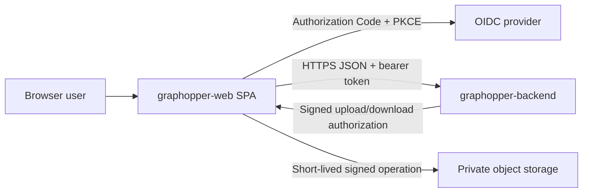
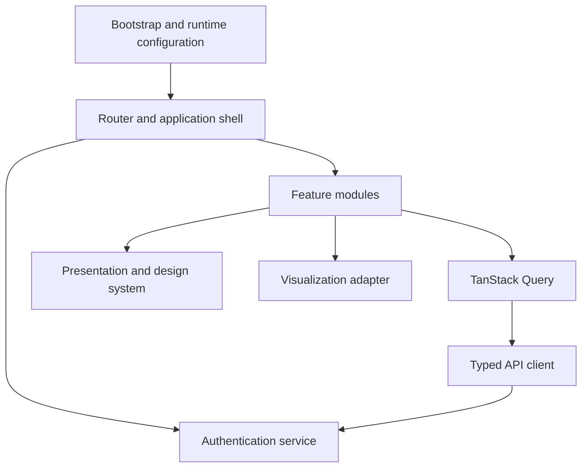
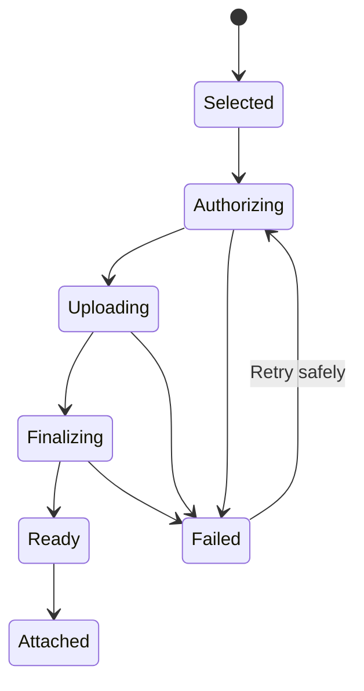

# graphopper-web Design

## 1. Document Status

This document defines the initial solution and software architecture for graphopper-web. It translates `REQUIREMENTS.md` into an implementable browser application design.

The design is authoritative for graphopper-web unless superseded by a recorded architecture decision. graphopper-backend's API contract remains authoritative for server behavior, business validation, authorization, persistence, errors, and resource representations.

Status: Initial architecture selected; implementation has not started.

## 2. Goals

graphopper-web shall:

- Provide an accessible browser interface for the complete initial graphopper-backend API.
- Keep graphopper-backend as the sole authority for private graph data and business rules.
- Make graph, template, node, relationship, traversal, and file workflows understandable without exposing backend implementation concepts unnecessarily.
- Present a useful visual graph while preserving list and detail alternatives for accessibility and large datasets.
- Handle authentication credentials, signed URLs, private graph values, and diagnostics safely.
- Remain independently deployable and replaceable without changing backend business rules.
- Support incremental delivery through feature-oriented modules and contract-backed tests.

## 3. Non-Goals

The initial architecture does not provide:

- Offline operation or synchronization.
- Server-side rendering for authenticated graph pages.
- A graphopper-web-owned user, graph, or file database.
- A backend-for-frontend or token-proxy service.
- Shared or real-time collaborative editing.
- Public graph publishing or search-engine-indexed graph content.
- Native desktop or mobile packaging.
- Bulk import, export, or background jobs.
- Browser-side enforcement of backend authorization or persistence invariants.
- A speculative shared UI or API package with graphopper-reactnative.

## 4. Architecture Decisions

### 4.1 Client-Rendered Single-Page Application

graphopper-web shall initially be a client-rendered single-page application (SPA). Authenticated graph data is private, user-specific, and not intended for search indexing, so server-side rendering does not justify its additional runtime, caching, credential, and deployment complexity.

The production artifact shall be static HTML, JavaScript, CSS, fonts, icons, and safe runtime configuration. The hosting layer shall serve `index.html` for application routes that do not map to static files.

Evolution trigger: introduce a server runtime or backend-for-frontend only if the selected identity provider cannot support a secure public browser client, browser token exposure becomes unacceptable for the threat model, or public server-rendered content is added.

### 4.2 Initial Implementation Stack

The initial implementation shall use:

- Node.js 24 LTS for development and build tooling.
- TypeScript 6 in strict mode.
- React 19 for the component model.
- Vite for development, bundling, code splitting, and static production output.
- npm with a committed lockfile.
- React Router in Declarative Mode for URL matching, navigation, and nested layouts.
- TanStack Query for remote server state, caching, invalidation, pagination, and mutation state.
- `openapi-typescript` for generated transport types and `openapi-fetch` for the typed HTTP client.
- React Hook Form for form state and Zod 4 for client-owned input schemas and runtime configuration validation.
- React Aria Components as the accessible behavioral foundation for common interactive controls.
- CSS Modules and CSS custom properties for component styling and design tokens.
- Cytoscape.js behind a local visualization adapter for graph rendering and interaction.
- Vitest, React Testing Library, Mock Service Worker, Playwright, and axe-core integrations for verification.
- ESLint and Prettier for source quality.

Exact compatible versions shall be pinned in `package-lock.json` during project setup. Major dependency upgrades require compatibility and accessibility review.

### 4.3 No General Global Client Store

The application shall not introduce Redux or another general global state container initially.

State ownership shall be divided deliberately:

- TanStack Query owns backend-derived server state.
- React Router and URL search parameters own navigable view state.
- React Hook Form owns form drafts and validation presentation.
- Component state owns transient interaction state such as open panels and local selection.
- The authentication service owns the in-memory OIDC session.

A global client store may be introduced only after a concrete cross-feature state requirement cannot be represented cleanly through these owners.

### 4.4 Contract-Generated Transport Boundary

graphopper-web shall not import source code or TypeScript types from graphopper-backend. It shall consume a versioned OpenAPI artifact through a controlled contract-sync process and keep the synchronized contract under `graphopper-web/openapi/`.

`openapi-typescript` shall generate transport-only types into `src/api/generated/`. Generated files shall not become domain or presentation models and shall not be edited manually.

CI shall:

1. Validate the synchronized OpenAPI document.
2. Regenerate transport types.
3. Fail if committed generated output is stale.
4. Run contract-focused client tests against representative responses.

Publishing a versioned backend contract artifact is preferred over reaching into another application directory. A local synchronization command may accept an explicit file or URL for development, but application source shall depend only on graphopper-web-owned generated output.

### 4.5 Browser OIDC with Authorization Code and PKCE

The initial client shall use OpenID Connect Authorization Code flow with PKCE as a public browser client. `oidc-client-ts` shall be isolated behind an `AuthenticationService` interface so provider-specific behavior does not leak through the component tree.

The initial credential policy is:

- Access and refresh tokens remain in memory.
- Tokens are never stored in `localStorage`, IndexedDB, URLs, analytics, diagnostics, or form drafts.
- Only short-lived OIDC transaction state needed to survive the redirect may use `sessionStorage`.
- The library's normal logging shall be disabled in production and shall never receive an application console logger containing tokens.
- API access uses the `Authorization: Bearer` header.
- Page reload may require a provider session check or a top-level authorization redirect to obtain a new token.

The exact issuer, client identifier, scopes, redirect URIs, sign-out URI, refresh-token policy, and provider-specific settings remain deployment decisions. The implicit flow and resource-owner-password flow shall not be used.

### 4.6 Accessible Components Before Custom Widgets

Common controls shall be composed from semantic HTML and React Aria Components rather than recreated from generic elements. Custom interaction shall follow WAI-ARIA Authoring Practices and remain keyboard and touch operable.

The graph canvas is an enhancement, not the only representation. A synchronized list/detail experience shall expose essential node and relationship content and operations independently of Cytoscape.js.

### 4.7 Visualization Behind an Adapter

Cytoscape.js shall be accessed through a graph-rendering adapter owned by the visualization feature. Domain features shall provide a neutral visualization model and shall not depend on Cytoscape types.

This boundary permits later replacement with Canvas, SVG, WebGL, or another graph library if accessibility, bundle size, layout quality, or measured performance is inadequate.

## 5. System Context and Trust Boundaries



Trust boundaries:

- All backend, identity-provider, URL, storage, and user-provided data is untrusted until validated for its use.
- The browser is not an authorization boundary.
- A valid token proves identity to graphopper-backend, not ownership of a requested resource.
- Signed storage URLs grant only their encoded operation and lifetime; they are sensitive bearer capabilities.
- Browser-delivered configuration is public even when served from an authenticated environment.
- The hosting layer, identity provider, graphopper-backend, and object-storage origins require explicit allowlisting.

## 6. Deployment and Runtime Model

### 6.1 Static Hosting

The application shall build into immutable, content-hashed assets suitable for a static host or CDN. `index.html` and runtime configuration shall use short or no-cache policies; content-hashed assets may use long-lived immutable caching.

The host shall provide:

- HTTPS.
- SPA history fallback.
- Correct content types.
- Compression.
- Security headers.
- A restrictive Content Security Policy.
- A deployment-specific `config.json` or equivalent public runtime configuration response.

### 6.2 Runtime Configuration

Runtime configuration shall be loaded and validated before rendering protected application routes. It shall contain only public values:

```ts
interface PublicRuntimeConfig {
  apiBaseUrl: string;
  appVersion: string;
  oidc: {
    authority: string;
    clientId: string;
    redirectUri: string;
    postLogoutRedirectUri: string;
    scope: string;
  };
}
```

The runtime schema shall reject missing values, malformed absolute URLs, non-HTTPS production endpoints, and unsupported configuration versions. Local development may explicitly allow loopback HTTP.

### 6.3 Same-Origin Preference

Serving graphopper-web and graphopper-backend through one public origin with distinct paths is preferred because it simplifies CORS and security policy. Separate trusted origins remain supported when graphopper-backend explicitly allowlists the web origin.

## 7. Internal Architecture



Dependency rules:

- `app` composes routes, providers, configuration, and error boundaries.
- Feature modules may depend on shared API, authentication, presentation, and utility interfaces.
- Shared layers shall not import feature modules.
- API transport models shall be converted at feature boundaries when presentation needs differ.
- Visualization types shall not escape the visualization feature.
- Tests may use public module interfaces but shall avoid reaching into internal component implementation.

### 7.1 Proposed Source Layout

```text
graphopper-web/
  openapi/
    graphopper-backend-v1.yaml
  public/
    config.example.json
  src/
    api/
      generated/
      client.ts
      errors.ts
      query-keys.ts
    app/
      bootstrap.tsx
      providers.tsx
      router.tsx
      shell/
    authentication/
      authentication-service.ts
      oidc-authentication-service.ts
      protected-route.tsx
    components/
      actions/
      feedback/
      forms/
      layout/
    features/
      graphs/
      templates/
      nodes/
      relationships/
      traversal/
      files/
      visualization/
    styles/
      tokens.css
      global.css
    testing/
      handlers/
      render.tsx
    configuration.ts
    main.tsx
  test/
    e2e/
```

Feature modules should colocate components, hooks, form schemas, mapping functions, and focused tests.

## 8. Routing and Navigation

The initial route map is:

| Route | Purpose | Authentication |
| --- | --- | --- |
| `/sign-in` | Sign-in entry and authentication errors | Public |
| `/auth/callback` | OIDC authorization callback | Public callback |
| `/auth/silent-callback` | Optional provider session callback | Public callback |
| `/` | Redirect to graph list or requested safe route | Required after redirect |
| `/graphs` | Paginated graph list and creation entry | Required |
| `/graphs/:graphId` | Graph overview and visualization | Required |
| `/graphs/:graphId/template` | Template fields and migration actions | Required |
| `/graphs/:graphId/nodes` | Node list, search, filters, and creation | Required |
| `/graphs/:graphId/nodes/:nodeId` | Node details and editing | Required |
| `/graphs/:graphId/relationships` | Relationship list and creation | Required |
| `/graphs/:graphId/relationships/:relationshipId` | Relationship details and editing | Required |
| `/graphs/:graphId/explore` | Bounded traversal workspace | Required |
| `/account` | Current-user and safe diagnostic information | Required |
| `*` | Application not found | Context-dependent |

Resource identifiers remain encoded URL path segments and opaque application values. Filter, sort, selection, and page-position state that users reasonably expect to bookmark or revisit should use URL search parameters. Signed URLs and credentials shall never be copied into application navigation state.

Protected routing shall wait for authentication initialization before deciding whether to redirect. The requested return path shall be accepted only when it is a safe same-application path.

## 9. Server State and Cache Policy

### 9.1 Query Keys

Query keys shall be factories based on resource scope rather than hand-built arrays scattered through components. Example hierarchy:

```text
['me']
['graphs', { sort, cursor }]
['graph', graphId]
['template', graphId]
['nodes', graphId, { filter, search, sort, cursor }]
['node', graphId, nodeId]
['relationships', graphId, { source, target, type, cursor }]
['relationship', graphId, relationshipId]
['graph-data', graphId, cursor]
['traversal', graphId, traversalRequest]
```

### 9.2 Staleness and Persistence

Server-state cache shall remain in memory and shall not be persisted to local storage initially. Defaults:

- Current user and graph metadata: stale after 60 seconds.
- Templates: stale after 5 minutes but invalidated by every template mutation.
- Node and relationship lists: stale immediately after navigation focus unless recently fetched; deduplicate concurrent requests.
- Traversal and graph-data results: keyed by the full bounded request and stale immediately after relevant mutations.
- Failed authentication responses: never retained as useful data.

Exact values may be tuned using measured behavior without changing the public contract.

### 9.3 Mutation Policy

Mutations shall not optimistically claim durable success by default. The application shall:

1. Submit the authoritative request.
2. Display pending state and prevent duplicate submission.
3. Apply the confirmed response to relevant detail caches.
4. Invalidate affected lists, graph data, traversal, and counts.
5. Remove deleted resources from visible caches only after confirmed success.

Low-risk local presentation may update optimistically later, but destructive and template-migration operations shall remain confirmation-driven.

### 9.4 Sign-Out and User Change

Sign-out, authentication failure, or detected user identity change shall cancel active requests where possible and clear the entire private query cache before another authenticated user can use the application.

## 10. API Client Design

### 10.1 Request Pipeline

The central client shall:

1. Resolve the validated API base URL.
2. Add `Accept: application/json` where applicable.
3. Obtain the current in-memory access token.
4. Add the bearer header only for the configured backend origin.
5. Add an idempotency key for eligible creation requests.
6. Add `If-Match` from the last confirmed ETag or resource version when required.
7. Apply an operation-appropriate abort signal and timeout.
8. Parse successful responses and the stable error envelope.
9. Retain response ETags and the API-version header as metadata.
10. Convert network, timeout, contract, and backend failures into a typed application error union.

The client shall not log full request or response bodies.

### 10.2 Error Model

```ts
type ApplicationError =
  | { kind: 'authentication'; code: string; requestId?: string }
  | { kind: 'backend'; code: string; message: string; details?: ErrorDetail[]; requestId: string }
  | { kind: 'network'; retryable: boolean }
  | { kind: 'timeout'; retryable: boolean }
  | { kind: 'contract'; summary: string }
  | { kind: 'unexpected'; reference: string };
```

Components shall branch on stable `kind` and backend `code`, not English message text.

### 10.3 Retries

- Queries may retry transient network failures and `5xx` responses with bounded exponential backoff and jitter.
- `401`, `403`, `404`, `409`, `412`, `422`, and `429` shall not use blind immediate retry.
- Mutations shall not automatically retry unless the operation is documented as idempotent or has a retained idempotency key.
- `429` handling shall honor `Retry-After` when supplied and otherwise require user-visible delay or action.

### 10.4 Cancellation and Timeouts

Navigation and changed query input shall cancel superseded requests using `AbortController`. Initial client deadlines:

| Operation | Client deadline |
| --- | ---: |
| Ordinary JSON query | 15 seconds |
| Ordinary mutation | 30 seconds |
| Traversal or graph data | 15 seconds |
| Upload authorization/finalization | 30 seconds |
| File transfer | No single fixed deadline; cancellation and progress required |

A client timeout does not prove that a mutation failed. The application shall preserve the idempotency key and offer a safe reconciliation or retry path.

## 11. Authentication Design

### 11.1 Authentication Service

```ts
interface AuthenticationService {
  initialize(): Promise<AuthenticationState>;
  signIn(returnPath?: string): Promise<never>;
  completeSignIn(url: string): Promise<string>;
  getAccessToken(): Promise<string | undefined>;
  signOut(): Promise<void>;
  subscribe(listener: (state: AuthenticationState) => void): () => void;
}
```

Components shall consume authentication state through a provider and shall not call `oidc-client-ts` directly.

### 11.2 Redirect Integrity

- OIDC state, nonce, and PKCE verifier validation is mandatory.
- Return paths shall be relative, normalized, and restricted to known application routes.
- Callback URLs shall remove authorization parameters from browser history after successful processing.
- Authentication errors shall be mapped to non-sensitive user messages.
- A callback shall not render private application content until processing completes.

### 11.3 Expiry and Renewal

The service shall observe access-token expiry. If provider-supported renewal succeeds, queries may continue. Otherwise, protected requests pause and the user is directed through authentication again. The application shall avoid redirect loops by retaining a bounded failure marker for the current tab.

### 11.4 Backend Authentication Failures

A backend `401` invalidates the local authenticated API state. One controlled renewal attempt may occur if the token is expiring or expired; repeated `401` responses shall clear private caches and require sign-in. An inaccessible resource `404` shall not be treated as proof of authentication failure.

## 12. Feature Design

### 12.1 Graphs

The graph list uses cursor pagination and retains active sort state in the URL. Creation and editing use dialogs or route-level forms with explicit save states. Graph deletion uses a typed confirmation requiring an affirmative action; typing the graph name may be added for additional protection but is not initially required.

The graph workspace provides summary, visualization, template, nodes, relationships, and explore navigation. Counts are shown only when returned or derived from a complete bounded response; partial client collections shall not be mislabeled as totals.

### 12.2 Templates

Template fields are ordered by `displayOrder` with stable identifier fallback. The editor maps supported field types to explicit controls and separates:

- Identity: stable ID, read-only.
- Naming: key and label.
- Type and required behavior.
- Default value.
- Display order and description.
- Supported validation rules.

The form keeps the graph/template ETag used to load it. Every template mutation supplies `If-Match`. After success, the template, graph, node lists, node details, graph-data, and traversal caches are invalidated according to impact.

Field deletion and graph-wide conversions use consequence-focused confirmation. Migration errors remain attached to the submitted draft until the user reloads or edits it.

### 12.3 Dynamic Node Forms

A field-component registry maps backend field types to input and display components:

| Field type | Edit control | Canonical submission |
| --- | --- | --- |
| `text` | Single-line text | String |
| `long_text` | Multiline text | String |
| `integer` | Numeric text input with integer parsing | JSON integer |
| `decimal` | Decimal text input | Canonical decimal string |
| `boolean` | Checkbox or select when optional | Boolean or cleared value |
| `date` | Date input with text fallback | `YYYY-MM-DD` |
| `date_time` | Date-time input with explicit zone handling | RFC 3339 instant/offset string |
| `url` | URL input | HTTPS string |
| `file` | Managed-file picker/uploader or permitted URL | File ID or HTTPS string |

Form values are keyed internally by stable field identifier. Labels and keys are presentation metadata. A missing optional value, an explicitly cleared value, and an unchanged value remain distinct form states so partial updates are correct.

Client validation mirrors only documented, deterministic usability rules. The backend error mapper attaches details by stable field ID and retains unmatched details in the form error summary.

### 12.4 Relationships

Relationship endpoint selectors query nodes from the active graph and show a meaningful node label plus a shortened opaque ID for disambiguation. The UI does not load every node eagerly; selection uses bounded search and pagination.

Source and target remain visually distinct. Direction is represented by words and icons, never color alone. Self-relations and parallel edges remain allowed when accepted by graphopper-backend.

### 12.5 Query Builder

The UI builds only allowlisted backend query operations. It never accepts raw SQL, JSONPath, regular expressions, or arbitrary sort expressions.

Filter controls are selected by field type. URL state stores a normalized, shareable description of the user-selected query, not the opaque backend cursor. Changing filter, search, or sort clears the cursor chain.

Cursor history is maintained in memory for previous/next navigation. Cursors are never decoded or edited by the UI.

## 13. Visualization Design

### 13.1 Visualization Model

```ts
interface VisualNode {
  id: string;
  label: string;
  secondaryLabel?: string;
  depth?: number;
}

interface VisualEdge {
  id: string;
  sourceId: string;
  targetId: string;
  label: string;
  type: string;
}
```

The adapter converts this model into Cytoscape elements and emits selection and viewport events using opaque IDs.

### 13.2 Node Labels

The label heuristic is deterministic:

1. A non-empty text value for a field whose key is `name`, if present.
2. The first non-empty text or long-text value in template display order.
3. `Node` followed by a short display-only fragment of the opaque ID.

The full ID remains available for copying. The short fragment is never used for API access or uniqueness decisions.

### 13.3 Layout

The initial adapter shall use Cytoscape's built-in layouts:

- `cose` for general graph and neighborhood exploration.
- `breadthfirst` for depth-oriented traversal results.
- `grid` as a deterministic reduced-motion or layout-failure fallback.

Layout executes only for a newly loaded dataset or explicit user request. Detail-panel changes shall not reset the viewport.

### 13.4 Bounded Rendering

The client shall never silently exceed backend graph-data or traversal limits. Initial client rendering guardrails are:

- Warn above 500 nodes or 1,000 relationships.
- Require explicit confirmation before rendering above those soft thresholds.
- Refuse a response exceeding 1,000 nodes or 2,000 relationships unless a later measured design supersedes these limits.
- Offer narrower traversal/filter actions when rendering is refused or truncated.

The visualization module and Cytoscape.js shall be lazy-loaded only when a visualization route is entered.

### 13.5 Accessible Parallel Representation

The same bounded dataset shall drive:

- A keyboard-accessible node list.
- A keyboard-accessible relationship list.
- A details region for the selected resource.
- Text describing truncation and active traversal constraints.

Canvas focus does not trap keyboard navigation. Selection changes initiated on the canvas shall update an announced status region without forcing focus unexpectedly.

## 14. Managed-File Design

### 14.1 Upload State Machine



The file field shall not submit a managed file ID into node values until finalization returns `ready`.

### 14.2 Transfer

The application shall request upload authorization from graphopper-backend, then send the bytes only to the returned short-lived URL with exactly the authorized headers. Upload progress requires `XMLHttpRequest` initially because standard Fetch upload progress is not consistently available; this use shall be isolated in the file-transfer adapter.

Redirects from signed transfer requests shall not be followed across unexpected origins. The authorized origin shall be checked against the returned URL and runtime policy.

### 14.3 Retry and Cancellation

Users may cancel an in-progress upload. A retry obtains new authorization unless the backend explicitly confirms the existing authorization remains valid. Node mutation remains separate from transfer status, and the UI states clearly whether the file is uploaded, finalized, and attached.

### 14.4 Preview and Download

Private preview/download begins with new backend authorization. Signed URLs remain only in memory, are not placed in router state, and are discarded after use or expiry. Potentially active content such as PDF is downloaded or rendered only under the deployment's documented sandbox policy.

## 15. Concurrency and Destructive Operations

ETags are retained alongside resource data rather than reconstructed from client state. Template mutations always require the graph/template version. Other updates send `If-Match` whenever supplied by graphopper-backend.

On `RESOURCE_VERSION_MISMATCH`, the application shall:

1. Keep the unsaved draft in memory.
2. Explain that authoritative state changed.
3. Offer to reload the current server value.
4. Show a comparison where practical.
5. Require deliberate resubmission against the refreshed version.

The client shall not automatically merge template migrations or destructive changes.

Destructive confirmations use a common dialog pattern with:

- Resource name and type.
- Known cascade consequences.
- A destructive action label naming the operation.
- A safe cancel action receiving initial focus.
- Focus restoration after completion or cancellation.

## 16. Presentation and Design System

### 16.1 Design Tokens

CSS custom properties shall define color, typography, spacing, radii, elevation, motion, and responsive breakpoints. Semantic tokens such as `--color-danger-text` shall be preferred over raw palette names in feature styles.

The initial application supports light and dark color schemes using the operating-system preference. A manual theme selector may be added later and, if added, may persist only the non-sensitive preference.

### 16.2 Component Layers

- React Aria Components provide accessible behavior for buttons, dialogs, menus, selects, tabs, tooltips, tables, and form controls.
- graphopper-web wrappers apply product semantics, error presentation, styling, and stable test access.
- Feature components compose those wrappers and do not restyle low-level accessibility behavior independently.

### 16.3 Feedback

- Inline feedback is used for field and local operation status.
- Page-level error summaries receive focus after rejected form submission.
- Toasts may announce secondary success but shall not be the only record of an error or required action.
- Skeletons may represent predictable content structure; indefinite spinners require accompanying status text.

## 17. Accessibility

WCAG 2.2 Level AA is the release target. The implementation shall specifically address:

- Logical heading and landmark hierarchy.
- Visible focus indicators.
- Skip navigation.
- Complete keyboard operation.
- Dialog focus containment and restoration.
- Programmatic form labels, descriptions, required states, and errors.
- Error summaries linking to invalid controls.
- Live-region announcements for important asynchronous outcomes.
- Minimum contrast in all supported themes and states.
- Reflow at 400% zoom without loss of essential workflow.
- Touch target sizing.
- `prefers-reduced-motion` and `prefers-contrast` where supported.
- Text and icon alternatives for graph direction, status, and truncation.

Automated checks are necessary but not sufficient. Release review shall include keyboard-only use and manual checks with at least VoiceOver/Safari and NVDA/Firefox or their current supported equivalents.

## 18. Responsive Layout, Browser Support, and Internationalization

### 18.1 Layout

Breakpoints are content-driven rather than device-branded. Initial layout modes:

- Narrow: single content column, collapsible navigation, full-screen editing panels.
- Medium: persistent top navigation with optional details drawer.
- Wide: navigation, visualization/list, and details may appear simultaneously.

Essential graph-management operations remain available in every mode. Large tables may switch to labeled cards rather than forcing horizontal page scrolling.

### 18.2 Browser Matrix

The release target is Vite's Baseline Widely Available production target, with automated end-to-end coverage in current Playwright Chromium, Firefox, and WebKit. The application shall not ship a legacy-browser bundle initially.

The published support policy shall list the concrete minimum versions produced by the selected Vite major. At the time of this design, Vite documents Chrome 111, Edge 111, Firefox 114, and Safari 16.4 as its production minimums; implementation shall re-verify these values when dependencies are pinned.

### 18.3 Locale and Time

The initial UI language is English. All source strings shall remain centralized enough to permit later localization; a translation framework is not required initially.

- Canonical API date and date-time strings remain unchanged in transport state.
- Display uses `Intl.DateTimeFormat` and `Intl.NumberFormat` with the browser locale.
- Date-only values are never shifted through a time zone.
- Date-time editors show the effective offset and submit an RFC 3339 value.
- Decimal editing preserves the backend's canonical decimal string rather than converting through imprecise floating-point arithmetic.

## 19. Security and Privacy

### 19.1 Content Security Policy

The production host shall define a CSP beginning from:

```text
default-src 'none';
base-uri 'none';
object-src 'none';
frame-ancestors 'none';
form-action 'self' <oidc-authority>;
script-src 'self';
style-src 'self';
img-src 'self' data: blob: <authorized-file-or-storage-origins>;
font-src 'self';
connect-src 'self' <api-origin> <oidc-origin> <authorized-storage-origins>;
```

Deployment may tighten or extend only the required origins. Inline script and `unsafe-eval` shall not be enabled in production. Development tooling may use a separate development-only policy.

### 19.2 Untrusted Text and URLs

Graph and backend text is rendered as text, not HTML. `dangerouslySetInnerHTML` is prohibited for backend or user content. If rich text is introduced later, it requires a separately reviewed sanitization design.

External URLs shall be parsed, restricted to allowed schemes, displayed clearly, and opened with `noopener` and `noreferrer` behavior. Redirect and return URLs are separately allowlisted.

### 19.3 Browser Storage

Allowed persisted browser data is limited initially to non-sensitive preferences such as theme. Tokens, graph payloads, node values, signed URLs, and API error bodies are not persisted. Session-only OIDC transaction state shall be namespaced and cleared after completion, failure, or expiry.

### 19.4 Headers

The production host shall also set:

- `Strict-Transport-Security` after HTTPS rollout is verified.
- `X-Content-Type-Options: nosniff`.
- `Referrer-Policy: no-referrer` or an equally restrictive reviewed policy.
- `Permissions-Policy` disabling capabilities not used by the application.
- Cross-origin isolation headers only if a measured feature requires them and storage/identity flows remain compatible.

### 19.5 Dependency and Supply-Chain Controls

- Commit and use the npm lockfile.
- Install with lockfile enforcement in CI.
- Review production dependency changes.
- Run dependency vulnerability and license checks in CI or release verification.
- Do not execute remote runtime scripts from CDNs.
- Generate a software bill of materials for release artifacts when deployment policy requires it.

## 20. Performance and Resource Budgets

Initial budgets, measured on production builds:

| Area | Budget |
| --- | ---: |
| Initial application JavaScript, gzip, excluding lazy visualization | 250 KiB |
| Lazy visualization JavaScript, gzip | 500 KiB |
| Initial CSS, gzip | 75 KiB |
| Long tasks during ordinary form/list interaction | No task above 200 ms on reference hardware |
| Graph render soft threshold | 500 nodes / 1,000 relationships |
| Graph render hard threshold | 1,000 nodes / 2,000 relationships |

User-experience targets on a representative mid-range device and broadband profile are LCP at or below 2.5 seconds, INP at or below 200 milliseconds, and CLS at or below 0.1 for the graph list and a small graph workspace.

Performance measures:

- Route-level code splitting.
- Lazy visualization loading.
- Debounced search with request cancellation.
- Paginated collections.
- Virtualization only after measured need and accessibility review.
- Memoized graph-model mapping based on immutable query results.
- No eager download or decode of private files.
- Bundle-size reporting in CI with hard budget failure before release.

## 21. Observability and Supportability

The initial application shall provide privacy-safe client diagnostics without product analytics.

Captured diagnostic metadata may include:

- Application version.
- Route template, not raw sensitive URL parameters.
- Operation name.
- Error category and stable backend error code.
- Backend request identifier.
- Browser family and broad version when explicitly included in a user-initiated support report.

It shall exclude:

- Tokens and OIDC responses.
- Signed URLs.
- Graph names and descriptions.
- Template labels and rules.
- Node values and relationship labels.
- Filenames and file contents.
- Full API request or response bodies.

Unhandled errors shall reach a route or application error boundary that offers safe recovery and a generated local reference. Introducing remote error reporting or analytics requires a privacy decision, data inventory, redaction tests, and deployment configuration.

## 22. Testing Strategy

### 22.1 Unit Tests

Vitest shall cover:

- Runtime configuration validation.
- Transport-to-view-model mapping.
- Node label selection.
- Dynamic field parsing and canonical submission.
- Error mapping.
- Safe return-path validation.
- Query-key factories and cache invalidation plans.
- Visualization-model conversion.

### 22.2 Component Tests

React Testing Library with user-event shall test behavior through accessible names and roles. Mock Service Worker shall intercept network requests at the HTTP boundary. Component tests shall cover loading, empty, success, backend error, concurrency conflict, and disabled/pending states.

Snapshot tests shall not replace behavioral assertions. Implementation-specific selectors are a last resort.

### 22.3 Contract Tests

Contract tests shall use generated OpenAPI types and representative fixtures to verify:

- Every consumed operation exists.
- Required request headers and bodies are formed correctly.
- Paginated and error envelopes are handled.
- ETags and API-version headers are retained.
- Unknown additive response properties do not break the client.
- Unsupported or malformed responses become contract errors.

### 22.4 End-to-End Tests

Playwright shall run critical flows in Chromium, Firefox, and WebKit:

1. Authenticate through a deterministic test identity provider or approved test auth boundary.
2. Create a graph and template.
3. Create and edit nodes.
4. Create and inspect a relationship.
5. Traverse and visualize a neighborhood.
6. Upload, attach, download, replace, and remove a file.
7. Handle a stale version.
8. Confirm destructive operations.
9. Verify a second user cannot access the first user's graph.

Tests shall run against a contract-conforming backend environment, not by accessing backend persistence directly.

### 22.5 Accessibility and Security Tests

- axe-core checks run on critical rendered states.
- Keyboard workflows cover navigation, dialogs, forms, tables/lists, and the visualization alternative.
- CSP and security headers are verified against the deployed artifact.
- Tests inject markup-like graph values and filenames to prove they remain inert text.
- Tests prove tokens and signed URLs do not enter logs, URLs, persisted storage, or error reports.
- Dependency and bundle checks run in CI.

### 22.6 Visual and Responsive Tests

Playwright screenshots shall cover selected stable states at narrow, medium, and wide viewports in light and dark color schemes. Visual comparison thresholds shall accommodate browser text rendering while detecting layout regression.

## 23. Build, Quality, and CI

The application shall expose documented commands for:

- Development server.
- Production build.
- Static preview.
- Formatting and formatting check.
- Linting.
- Type checking.
- Unit/component tests.
- End-to-end tests.
- OpenAPI synchronization and generated-type verification.
- Bundle-size analysis.
- A combined non-browser quality check.

CI shall use a clean lockfile installation and run, at minimum:

1. Formatting check.
2. ESLint.
3. TypeScript type checking.
4. Unit and component tests.
5. OpenAPI/generated-output verification.
6. Production build and bundle budgets.
7. Playwright critical-path tests in the release workflow.

Build output, caches, test videos from successful runs, local runtime configuration, credentials, and downloaded private files shall not be committed.

## 24. Requirements Traceability

| Requirement group | Primary design sections | Verification focus |
| --- | --- | --- |
| `FR-WEB-CORE-*` | 6–8, 16 | Routing, shell, history, drafts |
| `FR-WEB-CONFIG-*` | 4.4, 6, 10 | Runtime validation and API compatibility |
| `FR-WEB-AUTH-*` | 4.5, 5, 11, 19 | PKCE, expiry, storage, sign-out |
| `FR-WEB-GRAPH-*` | 8, 9, 12.1 | Graph lifecycle and confirmations |
| `FR-WEB-TEMPLATE-*` | 12.2, 15 | Dynamic schema editing and concurrency |
| `FR-WEB-NODE-*` | 12.3 | Dynamic forms, canonical values, deletion |
| `FR-WEB-REL-*` | 12.4 | Directed relationship workflows |
| `FR-WEB-VIEW-*` | 4.7, 13 | Bounded visualization and accessible alternative |
| `FR-WEB-QUERY-*` | 9, 12.5 | URL query state and cursor pagination |
| `FR-WEB-FILE-*` | 14, 19 | Signed operations, state machine, privacy |
| `FR-WEB-CONCURRENCY-*` | 9.3, 10, 15 | ETags, idempotency, reconciliation |
| `FR-WEB-ERROR-*` | 10, 16, 21 | Typed errors and safe recovery |
| `FR-WEB-SAFE-*` | 9.3, 15 | Confirmations and duplicate prevention |
| `FR-WEB-A11Y-*` | 4.6, 13.5, 16–17 | WCAG and manual assistive review |
| `FR-WEB-RESP-*` | 18 | Layout, browser matrix, locale |
| `FR-WEB-SEC-*` | 5, 11, 14, 19 | XSS, tokens, CSP, storage, privacy |
| `FR-WEB-PERF-*` | 13.4, 20 | Bundle, interaction, and rendering limits |
| `FR-WEB-SUPPORT-*` | 21 | Safe diagnostics and versioning |
| `FR-WEB-TEST-*` | 22–23 | Contract, browser, accessibility, security |

## 25. Risks and Evolution Triggers

| Risk | Initial mitigation | Evolution trigger |
| --- | --- | --- |
| Browser token exposure through XSS | Memory-only tokens, CSP, inert text rendering, no remote scripts | Adopt a backend-for-frontend if threat review requires browser-inaccessible tokens |
| Identity-provider renewal fails under browser privacy controls | Top-level code flow, bounded redirect handling, provider testing | Provider-specific BFF or session architecture |
| Graph rendering becomes slow | Backend limits, lazy Cytoscape, soft/hard client guardrails | Worker-based layout, WebGL renderer, or alternate projection after measurement |
| Canvas visualization is inaccessible | Parallel list/detail model and keyboard workflows | Replace or augment renderer if manual testing finds unresolved barriers |
| Generated contract drifts from backend | Versioned synchronized artifact and CI regeneration check | Publish a formal API package or contract registry after concrete reuse need |
| Dynamic forms duplicate business validation | Client validates usability only and always renders backend errors | Generate more validation metadata if backend contract becomes sufficiently expressive |
| Cached private data crosses sessions | In-memory cache and complete clearing on identity change | Add stronger isolation or full reload if testing finds leakage |
| Static hosting cannot meet auth/security needs | Public-client PKCE and strict hosting headers | Add server runtime or BFF |
| Bundle size grows | Route splitting, lazy visualization, CI budgets | Replace heavy dependencies or split features |

## 26. Resolved and Remaining Decisions

The initial architecture resolves the open requirements decisions as follows:

| Decision | Resolution |
| --- | --- |
| Language/framework/build | TypeScript 6, React 19, Vite, npm |
| Rendering | Client-rendered SPA with static hosting |
| Routing | React Router Declarative Mode |
| Authentication | OIDC Authorization Code + PKCE, memory-only tokens, `oidc-client-ts` adapter |
| API types | Synchronized OpenAPI artifact, `openapi-typescript`, `openapi-fetch` |
| Server state | TanStack Query, memory-only cache |
| Forms | React Hook Form and Zod for client-owned validation |
| Visualization | Cytoscape.js adapter plus accessible list/detail representation |
| Components/styling | React Aria Components, CSS Modules, CSS custom-property tokens |
| Testing | Vitest, Testing Library, MSW, Playwright, axe-core |
| Initial language | English, locale-aware display through `Intl` |
| PWA | Not included initially; static SPA only |
| Analytics | None initially |

The following remain deployment or implementation-detail decisions:

1. Exact OIDC provider, client registration, scopes, renewal, and logout behavior.
2. Public hostnames, same-origin routing, and trusted origin lists.
3. Static hosting/CDN and security-header configuration mechanism.
4. Exact versions pinned after compatibility testing.
5. Product visual identity, palette, typography, icon set, and logo assets.
6. Whether remote error reporting is approved and, if so, its provider and privacy configuration.
7. Concrete performance reference hardware and network profile.

## 27. Implementation Sequence

The recommended delivery order is:

1. Establish project tooling, runtime configuration, CI, application shell, tokens, and accessible component foundations.
2. Synchronize the backend contract and implement the typed API/error layer.
3. Implement OIDC authentication, protected routing, cache clearing, and current-user display.
4. Implement graph listing, creation, metadata editing, and deletion.
5. Implement template inspection, editing, concurrency, and migration errors.
6. Implement dynamic node forms, lists, filters, search, sorting, and pagination.
7. Implement relationship workflows and node endpoint selection.
8. Implement bounded graph data, traversal, Cytoscape visualization, and accessible alternatives.
9. Implement managed-file upload, finalization, preview/download, replacement, and removal.
10. Complete responsive behavior, accessibility review, security hardening, bundle budgets, cross-browser tests, and release verification.

Each delivery story shall update `REQUIREMENTS.md`, this document, contract fixtures, and appropriate tests when externally observable behavior or an architectural decision changes.

## 28. Reference Documentation

The initial decisions were checked against the following primary project documentation on 2026-10-19:

- [React versions](https://react.dev/versions)
- [Vite guide and browser support](https://vite.dev/guide/)
- [Vite production build compatibility](https://vite.dev/guide/build)
- [React Router modes](https://reactrouter.com/start/modes)
- [TanStack Query React documentation](https://tanstack.com/query/latest/docs/framework/react/reference)
- [OpenAPI TypeScript documentation](https://openapi-ts.dev/readme)
- [oidc-client-ts documentation](https://github.com/authts/oidc-client-ts/blob/main/docs/index.md)
- [React Aria project documentation](https://github.com/adobe/react-spectrum)
- [Cytoscape.js documentation](https://js.cytoscape.org/)
- [React Hook Form documentation](https://www.react-hook-form.com/)
- [Zod documentation](https://zod.dev/)
- [Vitest documentation](https://vitest.dev/guide/)
- [React Testing Library documentation](https://testing-library.com/docs/react-testing-library/intro/)
- [Mock Service Worker documentation](https://mswjs.io/docs/)
- [Playwright documentation](https://playwright.dev/docs/intro)
